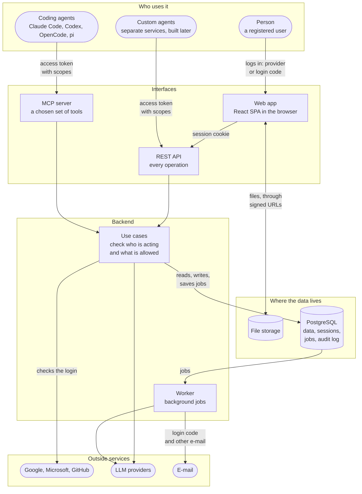
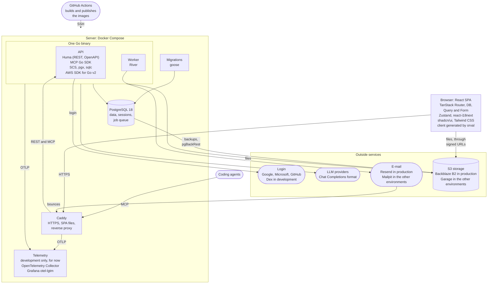

<!-- Main README. Keep README.pt-BR.md in sync with this file. -->

**English** | [Português](README.pt-BR.md)

<picture>
  <source media="(prefers-color-scheme: dark)" srcset="docs/design/brand/mark-on-dark.svg">
  
</picture>

# My Software Factory Manager

Client and project manager: a centralized platform for managing clients, projects and software development requests.

> **Status:** the foundation, the setup and the login are built. A new install runs in development and can be set up, with its consultancy and its first administrator, who then logs in, through a login provider or with a login code sent by e-mail, and lands in the shell of the app (see [Local development](#local-development)). The areas of work, such as clients and projects, and everything after them are not built yet; sections marked _TBD_ are filled in as the project evolves.

## Contents

- [About](#about)
- [Architecture](#architecture)
- [Tech stack](#tech-stack)
- [Build and deploy](#build-and-deploy)
- [Backup and maintenance](#backup-and-maintenance)
- [Documentation](#documentation)
- [License](#license)

## About

### Goal

The goal is to build a centralized platform for managing clients, projects and software development requests, serving as the operational hub of a software consultancy.

The idea is to have a single environment for managing the full lifecycle of a client and their projects, from first contact and requirements gathering through delivery, validation and maintenance of the solutions.

More than a simple task manager, the system should work as a smart digital office, organizing the information, documents, communication, requests and activities of each project.

### Problem it solves

_TBD._

<!-- Describe the current pain: where client and project information lives today, what gets lost or duplicated, and who suffers from it. -->

### Who uses it and how



Three kinds of caller reach the system, each through its own interface:

- **A person** uses the web app in the browser. They log in through Google, Microsoft or GitHub, or with a login code sent by e-mail, and only a registered user gets in.
- **Coding agents** use the MCP server, which offers a chosen set of tools: update the status of a project, look up clients and hours, fetch a credential.
- **Custom agents**, built later as separate services, use the REST API.

An agent enters with an access token that a user created for it, limited by scopes, and what it does is recorded as that user's. Every interface ends in the same use cases, which decide whether the action is allowed, so the rules are the same whoever is calling.

Data is read from and written to PostgreSQL. Files travel straight between the browser and the storage, through signed URLs that the API issues. Work that nobody waits for on a screen is saved as a job and run by the worker: sending e-mail, processing files, calls to LLM providers.

A user holds roles: the administrator and the developer exist from the setup on (see [ADR-0026](docs/adr/0026-a-role-is-a-record-that-grants-scopes-fixed-in-the-code.md)). What each role may do, its scopes, arrives with the areas that check them.

## Architecture

### Overview

Decided so far (see the ADRs below):



The worker runs the background jobs that the API saves in PostgreSQL: sending e-mail, processing files, calls to LLM providers that nobody waits for on a screen. The browser sends and fetches files straight to and from the storage, with signed URLs issued by the API.

In production the files are in Backblaze B2. In development and staging they are in Garage, behind a host name of Caddy.

Telemetry goes through the collector: traces and metrics from the API, the worker and Caddy, the output of every container, and the metrics of the server, PostgreSQL and the storage. It forwards everything to Grafana otel-lgtm, which keeps it for 30 days and sends the alerts by e-mail. Grafana has a host name of its own behind Caddy, with a login through GitHub. The two telemetry containers run in development only for now: production gets them when someone other than the maintainer uses the system, and until then a hosted monitor outside the server watches it.

The system runs in three environments: development on the maintainer's machine, staging on a server turned on by hand to try a pull request and turned off afterwards, and production on one server that is always on.

Frontend and backend live in this single repository:

```
.
├── apps/
│   ├── api/          # Go backend and API
│   └── web/          # the React app, with the design system in src/ui
├── deploy/           # Caddyfiles, Compose files of the servers, cloud-init
├── .github/          # pipeline workflows
├── docs/
│   ├── adr/          # architecture decisions
│   ├── agents/       # configuration for AI agents
│   └── design/       # analysis of the visual references
├── .scratch/         # local issues
├── compose.yaml      # development
└── Taskfile.yml
```

`apps/web` is the only JavaScript package, run through Vite+. It holds its own `package.json`, catalog and lockfile, and the root has none. A root Taskfile coordinates Go and frontend tasks: dev, build, test and code generation. No separate monorepo orchestrator is used.

Screens are built directly in the app, on the design system, with no prototype first. The design system is written in [`DESIGN.md`](DESIGN.md), which is the reference for every screen, and its components live in `apps/web/src/ui`.

The system is multilingual: English is the default, with Brazilian Portuguese and Spanish also supported, and each user chooses their language. Adding a language is a small code change with no database schema change.

<!-- Describe each component's responsibility and how they communicate. Update the diagram once the architecture is confirmed. -->

### Architecture decisions

Significant, hard-to-reverse decisions are recorded as ADRs (Architecture Decision Records) in `docs/adr/`, one file per decision. This README holds only the overview and the index below.

- [0001 - Go for the backend](docs/adr/0001-go-for-the-backend.md): Go over TypeScript and Rust, because agents write the code and the build loop must stay short
- [0002 - React SPA without a full-stack framework](docs/adr/0002-react-spa-without-a-full-stack-framework.md): Vite+ and TanStack Router behind Caddy, no Next.js or TanStack Start
- [0003 - OpenAPI contract generated from Go](docs/adr/0003-openapi-contract-generated-from-go.md): Go types are the source of truth for the REST API, via Huma
- [0004 - LLM providers and agents over HTTP](docs/adr/0004-llm-providers-and-agents-over-http.md): one internal interface for providers; agents are separate services that act only through the API
- [0005 - Multilingual from the start](docs/adr/0005-multilingual-from-the-start.md): English, Brazilian Portuguese and Spanish; the frontend translates API error codes; configuration content has a version per language, free text is translated on demand
- [0006 - Design system proven in a disposable prototype](docs/adr/0006-design-system-proven-in-a-disposable-prototype.md): shadcn/ui in `packages/ui`, shared by the product and a clickable prototype; superseded by ADR-0025, which keeps shadcn/ui; the style is monday.com's since ADR-0027
- [0007 - Backend organized by domain area](docs/adr/0007-backend-organized-by-domain-area.md): one package tree per domain area with dependencies pointing inward, a use case for every operation, selective tactical DDD and part of object calisthenics
- [0008 - Use cases served by several inbound adapters](docs/adr/0008-use-cases-served-by-several-inbound-adapters.md): a complete REST API and an MCP server with a chosen set of tools, both in the Go backend; access tokens with scopes; GraphQL, gRPC and WebSocket deferred
- [0009 - REST API conventions](docs/adr/0009-rest-api-conventions.md): snake_case, named operations with no PATCH, strict input, problem+json errors, cursor pagination, no versioning while every consumer ships with the backend
- [0010 - Sequential identifiers exposed through Sqids](docs/adr/0010-sequential-identifiers-exposed-through-sqids.md): integers inside, a type prefix plus a Sqids encoding outside (`prj_Xk9fQ2mB`), with alphabets fixed in the code
- [0011 - Login through external providers or a login code](docs/adr/0011-login-through-external-providers-with-a-server-side-session.md): Google, Microsoft and GitHub, or a six-digit code sent by e-mail; a server-side session behind an opaque cookie, registered users only
- [0012 - OpenTelemetry and a separate audit log](docs/adr/0012-opentelemetry-for-observability-and-a-separate-audit-log.md): traces and metrics sent through a collector to a Grafana container, logs read from the container output, alerts by e-mail; sensitive operations recorded in an append-only audit log
- [0013 - Frontend data in collections and cursor queries](docs/adr/0013-frontend-data-in-collections-and-cursor-queries.md): TanStack DB for bounded sets, TanStack Query with the API's cursor for the rest, Zustand for interface state only, a client and Zod schemas generated by orval, TanStack Form
- [0014 - Frontend organized by domain area](docs/adr/0014-frontend-organized-by-domain-area-and-tested-through-screens.md): one folder per domain area with a data module that alone calls the API; tests render whole screens in a real browser with a simulated API
- [0015 - Hand-written SQL checked by sqlc, and forward-only migrations](docs/adr/0015-hand-written-sql-checked-by-sqlc-and-forward-only-migrations.md): pgx and sqlc, goose migrations with no way back run as their own step, three database roles, PostgreSQL as the only database, with no cache and no connection pooler
- [0016 - Background jobs in PostgreSQL, run by a worker command](docs/adr/0016-background-jobs-in-postgresql-run-by-a-worker-command.md): River, a job saved in the transaction of its use case, a `worker` command of the same binary, few attempts and then a visible failure
- [0017 - Files in Garage, reached directly by the browser](docs/adr/0017-files-in-garage-reached-directly-by-the-browser.md): Garage in place of MinIO, only the S3 API through the AWS SDK for Go v2, uploads and downloads with short-lived signed URLs
- [0018 - Credential values encrypted by the API](docs/adr/0018-credential-values-encrypted-by-the-api.md): AES-256-GCM in the Go binary with a key from the deploy configuration, never in the database; a credential file is stored the same way
- [0019 - Three environments, with staging on a server created on demand](docs/adr/0019-three-environments-with-staging-on-a-server-created-on-demand.md): development on the machine, a staging server turned on and off by hand from the machine, which shows one labelled pull request and is seeded on every publish, production on one Hetzner server; GitHub Actions publishes over SSH, with secrets in GitHub Environments
- [0020 - PostgreSQL backed up by pgBackRest, and production files in Backblaze B2](docs/adr/0020-postgresql-backed-up-by-pgbackrest-and-production-files-in-backblaze-b2.md): continuous encrypted backups at another provider with a monthly restore test, and production files in a versioned bucket; Garage stays in development and staging
- [0021 - A public repository under AGPLv3](docs/adr/0021-a-public-repository-under-agplv3.md): public on GitHub's free plan, with the rules that being public sets for commits and for the pipeline
- [0022 - A record with a lifecycle is a state machine in the domain](docs/adr/0022-a-record-with-a-lifecycle-is-a-state-machine-in-the-domain.md): a fixed set of statuses and one transition table per aggregate, in plain Go; the allowed actions come from the same table, and only the name of a status is configuration content
- [0023 - A release names a milestone already in production](docs/adr/0023-a-release-names-a-milestone-already-in-production.md): one version for the whole system in a `VERSION` file; a release is a pull request that changes it and `CHANGELOG.md`, and the pipeline creates the tag after the publish
- [0024 - The first administrator is created in a setup opened by a setup code](docs/adr/0024-the-first-administrator-is-created-in-a-setup-opened-by-a-setup-code.md): a new install has no user; a setup code issued by a command on the server opens a setup that registers the consultancy and its first administrator together
- [0025 - The design system lives in the product, and there is no prototype](docs/adr/0025-the-design-system-lives-in-the-product-and-there-is-no-prototype.md): the prototype, the shared package and the gallery are removed; a screen is built directly in `apps/web`, which holds the components and is the only JavaScript package
- [0026 - A role is a record that grants scopes fixed in the code](docs/adr/0026-a-role-is-a-record-that-grants-scopes-fixed-in-the-code.md): the consultancy makes its own roles from a list of scopes fixed in the code; a user can have several, a session acts with the scopes of its user's roles, and the administrator role always grants every scope
- [0027 - The style follows monday.com, adjusted to WCAG AA](docs/adr/0027-the-style-follows-monday-com-adjusted-to-wcag-aa.md): the values of Vibe, monday.com's design system, in place of Zed's: a blue-grey frame with a white work surface, Figtree and Poppins, statuses as filled labels and rows in coloured groups, every pair measured against WCAG AA

## Tech stack

| Technology | Role in the project |
| --- | --- |
| [Go](https://go.dev/) | Backend and API |
| [Huma](https://huma.rocks/) | HTTP framework that generates the OpenAPI spec from Go types |
| [MCP Go SDK](https://github.com/modelcontextprotocol/go-sdk) | MCP server inside the backend, through which coding agents operate the system |
| [Sqids](https://sqids.org/go) | Short public identifiers encoded from the internal sequential ones |
| [SCS](https://github.com/alexedwards/scs) | Server-side sessions, stored in PostgreSQL |
| [env](https://github.com/caarlos0/env) | Reads the configuration from environment variables into one typed struct |
| [pgx](https://github.com/jackc/pgx) | PostgreSQL driver and the connection pool inside the API |
| [sqlc](https://sqlc.dev/) | Generates typed Go code from hand-written SQL |
| [goose](https://github.com/pressly/goose) | Applies the database migrations, forward only |
| [pgtestdb](https://github.com/peterldowns/pgtestdb) | Gives each database test its own temporary database |
| [testify](https://github.com/stretchr/testify) | Assertions of the Go tests |
| [River](https://riverqueue.com/) | Background jobs stored in PostgreSQL and run by the `worker` command, with a web panel |
| [AWS SDK for Go v2](https://github.com/aws/aws-sdk-go-v2) | Client for the S3 storage; signs the upload and download URLs |
| [go-mail](https://github.com/wneessen/go-mail) | Sends e-mail over SMTP in development and tests |
| [Resend](https://resend.com/) | Sends the e-mail in production and reports bounces |
| [Mailpit](https://mailpit.axllent.org/) | Container that captures the e-mail sent in development and tests |
| [OpenTelemetry](https://opentelemetry.io/) | Traces and metrics from the backend |
| [OpenTelemetry Collector](https://opentelemetry.io/docs/collector/) | Container that gathers traces, metrics and logs from every service and from the server |
| [Grafana otel-lgtm](https://grafana.com/docs/opentelemetry/docker-lgtm/) | One container that stores and shows the telemetry, and sends the alerts |
| [vacuum](https://quobix.com/vacuum/) and [oasdiff](https://github.com/oasdiff/oasdiff) | Lint of the API conventions and report of breaking changes on the OpenAPI spec |
| [golangci-lint](https://golangci-lint.run/) and [gofumpt](https://github.com/mvdan/gofumpt) | Linter and formatter of the Go code |
| [React](https://react.dev/) | Web frontend (single-page app) |
| [Vite+](https://viteplus.dev/) | Frontend toolchain behind one CLI (`vp`): dev server and build (Vite, Rolldown), tests (Vitest), lint (Oxlint), format (Oxfmt), plus the Node.js runtime and package manager |
| [TanStack Router](https://tanstack.com/router) | Typed client-side routing; filters and pagination live in the URL |
| [TanStack DB](https://tanstack.com/db) and [TanStack Query](https://tanstack.com/query) | Data from the API in the browser: collections for small sets, cursor queries for the rest |
| [TanStack Form](https://tanstack.com/form) and [Zod](https://zod.dev/) | Forms, validated with schemas generated from the OpenAPI spec |
| [Zustand](https://github.com/pmndrs/zustand) | Interface state shared between screens (theme, panels) |
| [orval](https://orval.dev/) | Generates the TypeScript client, the Zod schemas and simulated responses from the OpenAPI spec |
| [React Compiler](https://react.dev/learn/react-compiler) | Automatic memoization of components at build time |
| [Playwright](https://playwright.dev/) and [MSW](https://mswjs.io/) | Screen tests in a real browser with a simulated API (through Vitest), and end-to-end tests |
| [Knip](https://knip.dev/) | Finds unused files, exports and dependencies |
| [dependency-cruiser](https://github.com/sverweij/dependency-cruiser) | Checks the imports of the app against its dependency rule |
| [Chrome DevTools MCP](https://github.com/ChromeDevTools/chrome-devtools-mcp) | Lets coding agents investigate performance in a real Chrome |
| [react-i18next](https://react.i18next.com/) | Interface translations (English, Brazilian Portuguese, Spanish) |
| [shadcn/ui](https://ui.shadcn.com/) | Base of the design system: component code copied into `apps/web/src/ui`, on [Base UI](https://base-ui.com/) primitives |
| [Tailwind CSS](https://tailwindcss.com/) | Styling and the design system's style variables (light and dark themes) |
| [PostgreSQL](https://www.postgresql.org/) | Relational database (version 18), the only one in the system |
| [Garage](https://garagehq.deuxfleurs.fr/) | S3-compatible object storage (documents and files) in development and staging |
| [Backblaze B2](https://www.backblaze.com/cloud-storage) | S3-compatible object storage in production: the files and the database backups |
| [pgBackRest](https://pgbackrest.org/) | Continuous, encrypted backup of PostgreSQL, restorable to a point in time |
| [Dex](https://dexidp.io/) | Identity container behind the local login provider, in development and tests |
| [Hetzner Cloud](https://www.hetzner.com/cloud) | The production server, and the staging server created on demand |
| [GitHub Actions](https://docs.github.com/actions) | The pipeline: checks on every pull request, publishing, scheduled tests |
| [GitHub CLI](https://cli.github.com/) | How agents reach GitHub: pull requests, runs, secrets; and how turning staging on and off writes to the GitHub Environment of staging |
| [Caddy](https://caddyserver.com/) | HTTPS, static frontend files, reverse proxy to the API, security headers and the limit on the login code and the setup code |
| [Docker](https://www.docker.com/) | Packaging and running the services in containers (Docker Compose) |
| [Task](https://taskfile.dev/) | Task runner for the repository (dev, build, test, code generation) |
| [pnpm](https://pnpm.io/) | Frontend package manager, installed and run through Vite+ |

<!-- Add new technologies to this table as they are adopted. -->

## Build and deploy

### Prerequisites

| Tool | Minimum version | Where to get it |
| --- | --- | --- |
| Docker | Engine 28.3.2 with Compose 2.38.2 (Docker Desktop 4.43.2) | [Docker Desktop](https://docs.docker.com/desktop/), or Docker Engine with the Compose plugin on Linux |
| Go | 1.27.4 | [go.dev/dl](https://go.dev/dl/) |
| Vite+ (manages Node.js and pnpm) | 1.6.0 | [viteplus.dev](https://viteplus.dev/) |
| Task | 3.54.0 | [taskfile.dev](https://taskfile.dev/installation/) |
| GitHub CLI | 2.104.0 | [cli.github.com](https://cli.github.com/). To open pull requests and read the pipeline, and to turn staging on and off, logged in as the maintainer (`gh auth login`) with the token whose permissions are in [`docs/providers.md`](docs/providers.md#github) |

Each minimum is the version in use on the maintainer's machine, recorded in [`docs/machine-tools.yaml`](docs/machine-tools.yaml). No earlier version has been tried. Git clones the repository.

Development takes nine ports of the machine: 80 (Caddy), 5432 (PostgreSQL), 3900 (Garage), 1025 and 8025 (Mailpit), 5556 (Dex), 8081 (the River panel), 8080 (the API) and 5173 (Vite). A `.env` moves all but the last two (see below); Caddy forwards to those two.

The installed Go only downloads the toolchain that `go.mod` names. Every other version the build uses is pinned in the repository (see Versions in [`CODING_STANDARDS.md`](CODING_STANDARDS.md)).

### Configuration

The API binary reads its configuration from environment variables only, once, when it starts. A missing or invalid value stops the process before it serves anything, with a line that names the variable and never its value. The binary reads no `.env` and no configuration file: Task and Compose load the variables.

Every variable is listed in the committed `.env.example`, with no real secret.

The tool that turns staging on and off reads two variables that are not there, because they belong to the maintainer's machine and no server and no publish reads them from there: `HETZNER_TOKEN`, the API token of the Hetzner project of staging, which never reaches a server or GitHub, and `STAGING_MAILPIT_PASSWORD`, the password of the Mailpit of staging. Both go in the `.env` of the main checkout, which the tool reads also when it runs in a worktree. The token is written there by the maintainer; the password by the tool, the first time staging is turned on (see Deploy).

| Environment | Where the values are |
| --- | --- |
| Development | `.env.example`, whose values work as they are. A `.env` file, never committed, changes one: Task reads it first |
| Staging | The publish of the tool of the environments, which decides a value for every name of `.env.example` in `apps/api/tools/environment/variables.go`: fixed, derived from the publish (the address of the server, the commit, the password of Mailpit), drawn at random on each publish, or deliberately empty. It writes them to a variables file on the server, readable by the deploy user alone. The GitHub Environment `staging` holds only what reaches the server |
| Production | The GitHub Environment `production`: a secret for what is secret, a variable for the rest. The publish writes them to a variables file on the server, readable by the deploy user alone |

A new variable gets its staging value decided in `apps/api/tools/environment/variables.go`, and its production value set in the GitHub Environment `production`, before the merge. The publish compares the names in `.env.example` with the values it has and stops, before it logs in to the server, when one is missing.

A command of the binary requires only the variables it uses. The ones the binary reads today:

| Variable | What it is | Default |
| --- | --- | --- |
| `API_LISTEN_ADDRESS` | Where the API listens, as `host:port`. An empty host is every interface | None: the API requires it |
| `SHUTDOWN_DRAIN_DEADLINE` | How long the requests in flight have to finish once the API is told to stop | `20s` |
| `LOG_LEVEL` | The lowest level the binary logs: `debug`, `info`, `warn` or `error` | `info` |
| `OTEL_EXPORTER_OTLP_ENDPOINT` | Base URL of the OTLP/HTTP receiver the traces are exported to, such as `http://localhost:4318`. Empty exports nothing | Empty |
| `DATABASE_URL` | Connection URL of the API role, which reads and writes rows | None: the API, `issue-setup-code` and `worker` require it |
| `MIGRATION_DATABASE_URL` | Connection URL of the migration role, which owns the tables | None: `migrate` requires it |
| `DATABASE_POOL_MAX_SIZE` | The most connections the pool of the API opens | `10` |
| `DATABASE_STATEMENT_TIMEOUT` | How long one statement may run | `30s` |
| `DATABASE_IDLE_IN_TRANSACTION_TIMEOUT` | How long a transaction may sit idle | `1m` |
| `HEALTH_CHECK_TIMEOUT` | How long the check of a part may take, readiness included | `2s` |
| `APP_ORIGIN` | The address people open the app at: a scheme, a host and maybe a port, with nothing after them. `issue-setup-code` builds the address of the setup from it, and the API sends the cookie of the session over HTTPS only when it is `https`, and refuses a request that changes state with that cookie from any other origin | None: the API and `issue-setup-code` require it |
| `FILE_STORAGE_URL` | The origin where the API reaches the S3 API of the file storage | None: the API and `worker` require it |
| `FILE_STORAGE_PUBLIC_URL` | The origin where the browser reaches the file storage. A signed URL is signed for its host name | None: the API and `worker` require it |
| `FILE_STORAGE_REGION` | The region the file storage signs with | None: the API and `worker` require it |
| `FILE_STORAGE_BUCKET` | The one private bucket of the files | None: the API and `worker` require it |
| `FILE_STORAGE_ACCESS_KEY_ID` | The key the API signs with for the file storage | None: the API and `worker` require it |
| `FILE_STORAGE_SECRET_ACCESS_KEY` | The secret of that key. It is a secret, and never printed | None: the API and `worker` require it |
| `LOGIN_CODE_KEY` | The key the login codes are computed with: at least 32 bytes in hexadecimal, as `openssl rand -hex 32` writes them. It is a secret, and never printed. Changing it ends only the codes not yet used | None: the API and `worker` require it. `.env.example` holds one for development |
| `SEED_MAILBOX` | The mailbox the e-mail addresses of the seed are derived from: the administrator is its address tagged `+admin`, the developer `+developer`. Read by the seed binary, not by the API | None: `seed` requires it. `.env.example` holds a fictitious one |
| `WORKER_LIGHT_QUEUE_MAX_JOBS` | The most jobs of the light queue, such as sending an e-mail, that one worker runs at once | `10` |
| `WORKER_HEAVY_QUEUE_MAX_JOBS` | The most jobs of the heavy queue, such as converting a file, that one worker runs at once | `2` |
| `WORKER_SHUTDOWN_DEADLINE` | How long the running jobs have to finish once the worker is told to stop, before they are cancelled and left for the next worker | `20s` |
| `EMAIL_SENDER` | What the worker sends e-mail through: `smtp`, an SMTP server, or `resend`, the API of Resend, in production | None: `worker` requires it |
| `EMAIL_SMTP_ADDRESS` | The SMTP server, as `host:port` with a host: Mailpit outside production | None: `worker` requires it while `EMAIL_SENDER` is `smtp` |
| `EMAIL_FROM_ADDRESS` | The address every e-mail is sent from | None: `worker` requires it. `.env.example` holds a fictitious one |
| `EMAIL_FROM_NAME` | The name every e-mail is sent from | None: `worker` requires it. `.env.example` holds a fictitious one |
| `RESEND_API_KEY` | The key of the Resend account. It is a secret, and never printed | None: `worker` requires it while `EMAIL_SENDER` is `resend` |
| `RESEND_WEBHOOK_SECRET` | The signing secret of the webhook through which Resend reports a bounce, as Resend shows it: `whsec_` followed by the key in base64. With it, the API takes the notices at `/api/resend/bounces`, the address to register in Resend for the event `email.bounced`; without it, that path is unknown | Empty: no webhook |
| `LOCAL_LOGIN_PROVIDER_KEY` | The key of the local login provider, an OpenID Connect provider for development and the tests: it names the provider in the paths of its login (`/api/session/login_providers/<key>/...`), in its provider links and, as the way in, in the audit log. Lowercase letters, digits and underscores, starting with a letter, 64 at most | Empty: the local login provider is off |
| `LOCAL_LOGIN_PROVIDER_DISPLAY_NAME` | The name the login screen shows on the button of the local login provider | Empty: off |
| `LOCAL_LOGIN_PROVIDER_ISSUER_URL` | The issuer of the local login provider, whose discovery document the API reads at the first login through it. The browser and the API reach it at that same address | Empty: off |
| `LOCAL_LOGIN_PROVIDER_CLIENT_ID` | The client the system is at the local login provider | Empty: off |
| `LOCAL_LOGIN_PROVIDER_CLIENT_SECRET` | The secret of that client. It is a secret, and never printed | Empty: off |

The five `LOCAL_LOGIN_PROVIDER_` variables turn the local login provider on together, and the API refuses to start with some of them set and others empty; when it is on, a line of its log names it at the start. The client its redirect URL is registered for is the origin of the app followed by `/api/session/login_providers/<key>/callback`. `.env.example` turns it on, pointed at the Dex container of development; staging and production leave the five empty, and log in through the real login providers.

`.env.example` also holds what only development uses: the port and the passwords of the PostgreSQL container, the port of Caddy, the port of Garage and the secret its nodes share, the two ports of Mailpit, the port of Dex, the port of the River panel, the interface Vite listens on, the connection with which the Go tests create their temporary databases, and `RESEND_TEST_API_KEY`, the key of the tests against Resend, empty there. Garage creates its bucket and its key from the `FILE_STORAGE_` variables.

The variables of what is not built yet (Google, Microsoft and GitHub as login providers, and the rest) are _TBD_, each added with the code that reads it.

### Local development

Go, Vite+ and Task run on the machine, so a test runs without going through Docker. `task dev` runs the API, the worker and Vite. The `compose.yaml` at the root runs the services they talk to:

| Service | In development |
| --- | --- |
| Reverse proxy | Caddy |
| Database | PostgreSQL |
| File storage | Garage |
| Background jobs | The River panel, which shows the jobs and their queues |
| E-mail | Mailpit, which captures what is sent |
| Login | Dex as the local provider, or a login code read from Mailpit |
| LLM provider | A stand-in written in this repository, with fixed answers |
| Telemetry | The OpenTelemetry Collector and Grafana otel-lgtm, in a Compose profile that is off by default |

The seed fills the database with fictitious data, the same on every run. To work on a prompt against a real LLM provider, change the local `.env`.

The pipeline calls the same Task targets, so a check that fails there fails the same way on the machine.

Of the table above, PostgreSQL, Garage, Mailpit, Dex, the River panel and Caddy are what run today, beside the API, the worker and the app. From a clean machine to a concluded setup, with the prerequisites installed and Docker running:

1. Clone the repository with Git and open a terminal at its root. Every command below runs there.
2. `task install`. The first time, it downloads Node.js, pnpm, the JavaScript dependencies and the Chromium of the tests, about 330 MB.
3. `task services`. The first time, it builds the Caddy image, which takes a few minutes.
4. `task migrate`. The first time, Go downloads the modules of the API and builds it.
5. `task dev`, which starts the API, the worker and the app together. Leave it running.
6. In a second terminal, `task issue-setup-code`. It prints the setup code and the address of the setup, `http://localhost/setup`.
7. Open that address. The first load takes a while, because Vite bundles the dependencies of the app. Type the code, fill in the consultancy and its first administrator, a logo and a photo if you have them, review what you typed and conclude.

The app then leads to the login screen, which says the setup is concluded and that the administrator logs in below: with a login code, which Mailpit shows (see below), or through Dex when the e-mail of the administrator is one Dex knows. After the login the app opens its shell, in the preferred language of the user: the header with their menu, which logs out, the sidebar with the name and the logo of the consultancy, and a work surface that says the areas of work come next. `task e2e` runs the same path in a browser, on a database and a bucket of its own: the setup, a login through Dex, the logout, a login with a code read from Mailpit, and a person Dex knows who is no user.

To skip the setup, run `task seed` in place of steps 6 and 7. It registers a fictitious consultancy, Fábrica Exemplo, and its administrator, Ana Exemplo, through the same use cases the setup runs, so the data obeys every rule, and the app opens on the login screen. Every run on an empty database creates the same data with the same identifiers, and a run on a database whose setup is concluded changes nothing. The administrator's e-mail is the mailbox of `SEED_MAILBOX` tagged `+admin`: `seed+admin@fabrica.example` with the value of `.env.example`. Nothing in the seed is real.

The browser reaches everything through Caddy, at one address, `http://localhost`: the app, and the API under `/api`. The file storage has a host name of its own, `http://files.localhost`, where the browser sends an image to a URL the API signed; Garage accepts it from the origin of the app only. Nothing is configured by hand: the values of `.env.example` work as they are with Docker Desktop. With Docker Engine on Linux, Caddy reaches the API and Vite only when they listen on every interface: write `API_LISTEN_ADDRESS=0.0.0.0:8080` and `WEB_LISTEN_HOST=0.0.0.0` in a `.env`. When port 80 is taken, change `CADDY_PORT` there and add the port to `APP_ORIGIN` and to `FILE_STORAGE_PUBLIC_URL`.

The worker runs the jobs the API saves, in a light queue and a heavy queue. Its first job delivers an e-mail: every e-mail the system sends is a record, and its job writes it in the language of the recipient and sends it through SMTP, or through Resend in production, which reports a bounce back to the API. In development the e-mail goes to Mailpit, which keeps it and delivers nothing: its screen, at `http://localhost:8025` (`MAILPIT_PORT`), shows every e-mail sent. The login code is the first e-mail the system asks for: on the login screen, type the e-mail of a user and "Send a code", and Mailpit shows the code a moment later, in the preferred language of the user; type its six digits on the screen. Without the screen, `curl -i -c cookies.txt -X POST http://localhost/api/session/login_code -H "Content-Type: application/json" -d '{"email":"<the e-mail of a user>"}'` answers 202 for every e-mail, and sends the code only when the e-mail belongs to an active user. With the same cookie, `curl -i -b cookies.txt -c cookies.txt -X POST http://localhost/api/session/login_code/check -H "Content-Type: application/json" -d '{"code":"<the six digits>"}'` logs the user in (204), `curl -b cookies.txt http://localhost/api/session` tells who is logged in, and `curl -i -b cookies.txt -X POST http://localhost/api/session/log_out` logs out. Every hour, and once when it starts, the worker also cleans up the file storage: it removes the uploads never confirmed a day after they started, and the objects more than a day old that no confirmed file names. The River panel shows the jobs of the development database at `http://localhost:8081` (`RIVER_PANEL_PORT`); it runs in development only, until the API serves it to administrators.

The local login provider is Dex, at `http://localhost:5556` (`DEX_PORT`), which knows two people of the seed, with fixed passwords that are fictitious too:

| E-mail | Password | In the system |
| --- | --- | --- |
| `seed+admin@fabrica.example` | `local-provider-admin` | Ana Exemplo, the administrator the seed creates |
| `seed+developer@fabrica.example` | `local-provider-developer` | No user yet: the login is refused with the notice of an e-mail of no active user |

The login screen shows a button for it, "Log in with Local login provider", above the login with a code; the button, like opening `http://localhost/api/session/login_providers/local/start` in the browser, sends the browser to the login page of Dex; once the person logs in there, Dex sends the browser back to the API, which logs the administrator in and returns to the root of the app, or to the path of the app in `?return_to=`. The first login through Dex finds the user by the e-mail Dex says is verified and links the account; the later ones find the user by that link. `http://localhost/api/session/login` tells the providers turned on and, after a refused login, its e-mail. Dex keeps what it needs in memory, so a login in flight does not survive its restart; the people it knows are in its configuration, in `compose.yaml`. Logging in as the developer brings the login screen back with the notice and the e-mail.

`http://localhost/up` answers with the status of the readiness of the API and no body: 503 until the migrations are applied, and 502 while the API is not running. The API itself answers liveness at `http://127.0.0.1:8080/livez` and readiness at `http://127.0.0.1:8080/readyz`, which Caddy does not forward. On a server, the command `probe-readiness` of the API binary asks the API in its container the same, as the health check of Compose, since the image has no shell.

A new install has no user and no consultancy. `task issue-setup-code` issues the setup code that opens the setup and prints, to the output of the command itself, the code, when it stops working, what it opens and the address of the setup. The code lasts one hour, and a new one ends the one before. Only its hash is stored, so a code that was lost cannot be read back: issue another. On a server, the same command of the API binary, `issue-setup-code`, runs inside the API container. The app takes the code at the address of the setup, `/setup`: until the setup is concluded, every address of the app leads there. Once it is concluded, the same command is the way back in when no administrator can log in: the code it issues opens `/setup` at the step of the administrator and registers a new one, and no user that exists is changed.

The commands, run from the repository root:

| Command | What it does |
| --- | --- |
| `task install` | Installs the JavaScript dependencies, and the Chromium the screen tests run in. Vite+ downloads the versions of Node.js and pnpm that `apps/web/package.json` names |
| `task services` | Builds the Caddy image, starts the services of development in Docker (PostgreSQL, Garage with its bucket, its key and its cross-origin rule, Mailpit, Dex, the River panel and Caddy) and waits until they are healthy. Every checkout of the repository, a Git worktree included, drives the same containers |
| `task services:stop` | Stops the services of development and keeps their data |
| `task migrate` | Applies the pending migrations to the development database. A second run applies nothing |
| `task issue-setup-code` | Issues a setup code in the development database and prints it, with when it stops working, what it opens and the address of the setup |
| `task seed` | Fills the development database with the fictitious consultancy and its administrator, through the use cases of the setup, so the app opens on the login screen. On a database whose setup is concluded it changes nothing |
| `task seed:image` | Builds the image of the seed, `software-factory-manager-seed:servers`, which staging runs, and publishes nothing. The pipeline runs it on every pull request |
| `task api:image` | Builds the image of the API, `software-factory-manager-api:servers`, which the servers run with each command of the binary, and publishes nothing. The pipeline runs it on every pull request |
| `task caddy:image` | Builds the web app with `task web:build`, then the Caddy image of the servers with the app inside, `software-factory-manager-caddy:servers`, and publishes nothing. The pipeline runs it on every pull request |
| `task dev` | Starts the API, the worker and Vite together. The app opens at `http://localhost`, through Caddy |
| `task api` | Starts the API alone, at `http://127.0.0.1:8080` |
| `task worker` | Starts the worker alone, which runs the jobs of the development database. It stops at once when a migration is pending |
| `task web` | Starts Vite alone, at port 5173, behind Caddy |
| `task api:build` | Builds the API binary into `apps/api/bin` |
| `task web:build` | Builds the web app for the servers into `apps/web/dist`, with a Brotli copy beside each text file |
| `task api:test` | Starts the services and runs the Go tests. A test that needs PostgreSQL creates its own temporary database there; a test of the file storage writes objects of its own to the bucket of Garage and removes them; a test of the SMTP adapter sends to Mailpit, to an address of its own, and reads the e-mail back through its API; a test of the login through a provider logs in at Dex, driving its login page over HTTP. Arguments after `--` replace the list of packages |
| `task api:test:resend` | Runs the tests of the Resend adapter against Resend itself, sending to its test addresses, which deliver nothing, with the key in `RESEND_TEST_API_KEY`. Without the key they skip. The scheduled workflow `resend.yml` runs them every day, never a pull request |
| `task db:clean` | Drops the databases the Go tests leave in the development PostgreSQL, the ones named `test_...` and `testdb_...`: the database of a test that failed or was killed, and a template of pgtestdb for each state the migrations had. No other database is touched, neither `software_factory` nor `software_factory_e2e`. Run it when no test runs, now and then or when the list of databases grows: a database still in use is not dropped, and the command stops on it |
| `task api:lint` | Lints the Go code and checks its format, the imports between layers and between domain areas, `else` and the level of nesting |
| `task api:format` | Rewrites the Go files as the formatter asks |
| `task versions:check` | Checks that every version the repository pins is exact: no range, no `latest`, no floating tag |
| `task compose:check` | Checks the Compose file of staging with `docker compose config --quiet`, which prints nothing |
| `task workflows:check` | Checks the workflow files with actionlint and zizmor, each run from its Docker image |
| `task api:generate` | Generates, with sqlc, the Go code of the `postgres` adapters from the SQL files of each one. What it writes is committed |
| `task api:generate:check` | Fails when the committed code that sqlc generated is stale |
| `task api:spec` | Generates the OpenAPI spec from the Go code, into `apps/api/openapi.yaml`. What it writes is committed |
| `task api:spec:check` | Fails when the committed OpenAPI spec is stale |
| `task api:lists` | Writes the countries, the currencies and the time zones the API accepts into the app, at `apps/web/src/shared/places/lists.gen.ts`. What it writes is committed |
| `task api:lists:check` | Fails when the committed lists of the app are not the ones the API accepts |
| `task api:spec:lint` | Lints the committed OpenAPI spec with vacuum: names in `snake_case` and resources in the plural |
| `task api:spec:breaking` | Shows, with oasdiff, the breaking changes of the OpenAPI spec against `origin/main`. A breaking change does not fail it; a failure of oasdiff itself, such as a revision it cannot read, does. `SPEC_BASE=<revision>` compares with another revision |
| `task web:generate` | Generates, with orval, the API client of the app, its Zod schemas and its simulated responses from `apps/api/openapi.yaml`, into `apps/web/src/shared/api/generated`. What it writes is committed |
| `task web:generate:check` | Fails when the committed client that orval generated is stale |
| `task web:imports` | Fails when an import of the app breaks its dependency rule, with dependency-cruiser |
| `task web:knip` | Fails on a file, an export or a dependency of the app that nothing uses, with Knip |
| `task e2e` | Runs the end-to-end test of the setup and the login in Chromium, through Caddy, with Playwright: the setup, a login through Dex, the shell and the logout, a login with a code read from Mailpit, and the limits of Caddy. It starts the services, Mailpit and Dex among them, builds the API, restarts Caddy so that its limits start empty, creates the database `software_factory_e2e` empty and applies the migrations, and creates the bucket `software-factory-e2e-files` in Garage on its first run; Playwright starts the API, the worker and Vite on that database and that bucket, and stops them at the end. The development database and its bucket are not touched. Ports 8080 and 5173 must be free: stop `task dev` first. A failed test leaves its trace in `apps/web/test-results`, which `vp exec playwright show-trace <file>`, run in `apps/web`, opens |
| `task check` | Runs every check of a pull request: the exact versions, the check of the workflow files, the check of the generated client, the format, lint and type checks of `apps/web`, its dependency rule, its unused code, its missing translation keys and its tests, then the lint of the API, the check of the generated code, the check of the OpenAPI spec, the check of the lists of the app, the lint and the breaking-change report of the spec, the build of the API, the build of the web app and the three images a commit is published with, the tests of the API, and the end-to-end test. Because of the end-to-end test it needs ports 8080 and 5173 free and restarts Caddy: stop `task dev` first |
| `task check:quick` | Runs everything `task check` runs except the end-to-end test, for daily use. It needs no free port and does not restart Caddy, so it runs beside `task dev`. Before a pull request, run `task check` |
| `task check:fix` | Runs the format, lint and type checks of `apps/web` and fixes what can be fixed |

sqlc runs with `go tool`, from a module file of its own, `apps/api/sqlc.mod`. The first time on a machine, Go downloads and builds sqlc, which takes several minutes: one of its dependencies has more than a hundred thousand files, and extracting them on Windows can take half an hour. The command looks idle meanwhile. Do not interrupt it, because the extraction starts over. vacuum and oasdiff run the same way, from `apps/api/vacuum.mod` and `apps/api/oasdiff.mod`, and each is built in a few minutes the first time. So does River's CLI, from `apps/api/river.mod`, which exports the SQL of River's tables for a migration: `go tool -modfile=river.mod river migrate-get --line main --version <n> --up`, run in `apps/api` (see Jobs in [`CODING_STANDARDS.md`](CODING_STANDARDS.md)).

The REST contract is `apps/api/openapi.yaml`. It is generated from the operations the API serves, so after changing one, run `task api:spec` and commit the file with the code.

### Build

- **Backend.** One Go binary, in one image: the API, plus the `worker`, `migrate`, `issue-setup-code` and `probe-readiness` commands. The migrations are embedded in it.
- **Seed and LLM stand-in.** Each is a `main` package of its own in the same Go module, built into its own image. Production runs neither.
- **Frontend.** Vite+ builds `apps/web` into static files, with a Brotli copy beside each text file. Caddy serves them.
- **Caddy and PostgreSQL.** Both images are built in this repository: Caddy with a rate-limit plugin, and on the servers with the built web app inside; PostgreSQL with pgBackRest.
- **Generated code.** The pipeline checks that it is up to date: the Go code sqlc generates from the SQL files, the OpenAPI spec generated from the Go code, and the client orval generates from that spec.
- **Versions.** The build installs from `go.sum` and `pnpm-lock.yaml` and fails when they would change.
- **Images.** GitHub Actions builds them, tags each with the hash of its commit and pushes it to the GitHub container registry. Production runs only an image built from `main`. The images of a release also carry its number.

`task api:build` builds the API binary into `apps/api/bin`. The image of the seed is built from `apps/api/cmd/seed/Dockerfile` by the `seed` service of `compose.yaml`, which lives in a Compose profile of its own so that `task services` does not start it: `docker compose --profile seed run --rm --build seed` builds it and runs it on the development database. `task api:image` builds the image of the API from `apps/api/cmd/api/Dockerfile`, and `task caddy:image` builds the web app, with `task web:build`, and then the stage `servers` of `deploy/caddy/Dockerfile`, with the output of the build as its context; development builds the stage `development` of the same file, which holds no app. Each of the three is built on every pull request and published nowhere. The other commands are _TBD_, each written with what it builds.

### Deploy

Every change reaches `main` through a pull request, and a merge into `main` is published to production once the pipeline passes. GitHub Actions builds the images, pushes them to the GitHub container registry and logs in to the server over SSH to pull them and restart the Compose services. The secrets of each environment are in GitHub Environments, and the publish writes them to a variables file on the server (see [ADR-0019](docs/adr/0019-three-environments-with-staging-on-a-server-created-on-demand.md)).

Staging is a server that exists only while a pull request is tried on it, and costs only while it is on (see [`docs/providers.md`](docs/providers.md)). It is turned on and off by hand, from the main checkout or a worktree of it:

```sh
task staging:on      # create the server, wait until it is ready, and give GitHub what reaches it
task staging:status  # on or off, since when, its address, its host names and the labelled pull request
task staging:off     # destroy the server, with its address and its deploy key, and take them out of GitHub
```

The machine needs `HETZNER_TOKEN` in the `.env` of the main checkout: an API token of the Hetzner project `software-factory-manager-staging`, with read and write permission. It also needs `gh` logged in as the maintainer, with the permissions that the row "Token of `gh` on the maintainer's machine" gives, in the GitHub section of [`docs/providers.md`](docs/providers.md#github). `task staging:on` makes sure the GitHub Environment `staging` and the label `staging` exist, creates the server from the choices in `deploy/server.staging.yaml`, prepared by `deploy/cloud-init.yaml`, and returns once the server answers SSH with the host key it was given and cloud-init has prepared it, and the GitHub Environment `staging` has what the pipeline needs to reach it: the address, the host key and the deploy key of the server, and the password of Mailpit. When that fails, it destroys the server and takes those values out of GitHub before it reports the failure. Turning staging on when it is on creates nothing and gives GitHub the same values again; turning it off when it is off destroys nothing. Nothing turns it off by itself: once it has been on for more than 24 hours, the scheduled workflow `staging-reminder.yml` fails every six hours, which warns the maintainer, until it is turned off. `task staging:off` leaves only the password of Mailpit in GitHub.

The password of Mailpit is chosen the first time staging is turned on and kept in the `.env` of the main checkout, as `STAGING_MAILPIT_PASSWORD`: read it there, since GitHub never gives a secret back. Every later turn-on uses the same one.

While staging is on, the main checkout keeps its deploy key in `.servers/staging/`, which git ignores, and `ssh -F .servers/staging/ssh_config staging`, run there, logs in to the server as the deploy user. Its host names are under its address, written for `sslip.io`, which is provisional until the domain is registered (see [`docs/providers.md`](docs/providers.md#sslipio)): they change each time staging is turned on, and `task staging:status` prints them.

A pull request of this repository that has the `staging` label is published to staging once its checks pass, by the job `Publish to staging` of `ci.yml`: it builds the three images of the commit the checks tested, pushes them to the GitHub container registry, tagged with its hash, and runs `go run ./tools/environment publish staging`, the publish of the same tool. That logs in to the server over SSH as the deploy user, trusting only its host key, copies the Compose files and Caddy's configuration, writes the variables file, pulls the images, stops the API and the worker, removes PostgreSQL, Garage and Mailpit with their data, starts the three again with Caddy, applies the migrations, runs the seed, starts the API and the worker, and waits until `/up` answers over HTTPS. A comment on the pull request then gives the address of the app and of Mailpit, whose user is `maintainer` and whose password is `STAGING_MAILPIT_PASSWORD`. The data is the seed's: log in as `seed+admin@fabrica.example` with a login code, read in Mailpit. When staging is off, the job publishes nothing, says so in a notice and passes. Only one publish runs at a time, and a running one is never cancelled, unless its label is taken off by hand and added again while it publishes, which publishes the pull request again.

Staging shows one pull request at a time. Adding the `staging` label to a pull request that is open runs its checks again and publishes it; adding another label publishes nothing. A publish takes the label off every other open pull request that has it, with a comment there naming the pull request staging shows now, so that a push to one of them publishes nothing; adding the label to it again publishes it again. A pull request that lost the label, or was closed, before its publish started is not published.

Going back to an earlier version is a manual workflow that publishes an earlier commit of `main`, named by its hash or by a release.

A release gives a number and notes to a milestone that is already in production. It is a pull request that changes `VERSION` and `CHANGELOG.md`. After it is published, the pipeline creates the tag, the GitHub Release and the numbered tag on the images (see [ADR-0023](docs/adr/0023-a-release-names-a-milestone-already-in-production.md)). The first release, 0.1.0, is still to come.

A deploy restarts the single API instance. The API finishes the requests in flight before it exits (see Shutdown in [`CODING_STANDARDS.md`](CODING_STANDARDS.md)), so the Compose file gives it a `stop_grace_period` of 45 seconds. Caddy holds no request meanwhile: until the new instance accepts connections, it answers a request to `/api` with a 502 in the error format of the API (see API out of reach in [`CODING_STANDARDS.md`](CODING_STANDARDS.md)).

Before the API starts, a one-shot Compose service applies the pending database migrations, and the API starts only when it succeeds. When a migration is pending, the deploy takes a `pg_dump` first, because migrations have no way back (see [ADR-0015](docs/adr/0015-hand-written-sql-checked-by-sqlc-and-forward-only-migrations.md)).

The worker is a second service of the same image, started with the `worker` command. On a deploy it stops taking jobs and gives the running ones time to finish. A job that is cut runs again later (see [ADR-0016](docs/adr/0016-background-jobs-in-postgresql-run-by-a-worker-command.md)).

The commands are _TBD_, written with the first code.

## Backup and maintenance

### Backup

| What | How | Frequency | Retention |
| --- | --- | --- | --- |
| Database (PostgreSQL) | pgBackRest, encrypted, to a bucket at Backblaze B2 | Write-ahead log continuously, a differential backup every day, a full one every week | 30 days, restorable to any moment |
| Database, before a migration | `pg_dump` taken by the publish, kept on the server | Each publish with a pending migration | The last three |
| Files (Backblaze B2) | Object versioning on the production bucket | Every change | An old version for 30 days |

The backups are at a provider other than the one of the server. The key that encrypts credential values and the passphrase of the backups are never stored with them: they are secrets of the GitHub Environment, with a copy in the maintainer's password manager. A monitor outside the server warns when a backup does not report (see [ADR-0020](docs/adr/0020-postgresql-backed-up-by-pgbackrest-and-production-files-in-backblaze-b2.md)).

### Restore

Every month a scheduled workflow creates a server, restores the latest backup there, checks it and destroys the server.

The steps to restore by hand are _TBD_, written with the backup routine.

<!-- Step by step to restore the database and files from a backup. -->

### Maintenance

- **Dependencies.** `task outdated` lists what has a newer release. A weekly workflow runs it and keeps the list in one GitHub issue, which warns the maintainer; it opens no pull request. `task outdated:machine`, run by hand, does the same for the tools installed on the maintainer's machine. Each update is its own pull request (see Versions in [`CODING_STANDARDS.md`](CODING_STANDARDS.md)).
- **Vulnerabilities.** A weekly workflow runs govulncheck, `pnpm audit` and Trivy on the images.
- **Logs.** In production, the output of the containers is read on the server.

The rest is _TBD._

<!-- Recurring routines still to describe: credential rotation, updating the servers. -->

## Documentation

- `docs/adr/`: architecture decisions (ADRs).
- `GLOSSARY.md`: glossary of domain terms.
- [`CODING_STANDARDS.md`](CODING_STANDARDS.md): how code is written, for agents and for review.
- [`DESIGN.md`](DESIGN.md): the design system: its rules, style variables, components and recipes.
- [`docs/providers.md`](docs/providers.md): the outside services the system depends on, with the reason, the cost and what is configured at each.
- [`docs/design/`](docs/design/): analysis of the visual references behind the design system.
- [`docs/agents/`](docs/agents/): configuration used by AI agents in this repository.

`docs/adr/` and `GLOSSARY.md` are created as the domain and the architecture are defined. `CHANGELOG.md`, with what changed in each release, is created with release 0.1.0.

## License

[GNU Affero General Public License, version 3](LICENSE). See [ADR-0021](docs/adr/0021-a-public-repository-under-agplv3.md).
