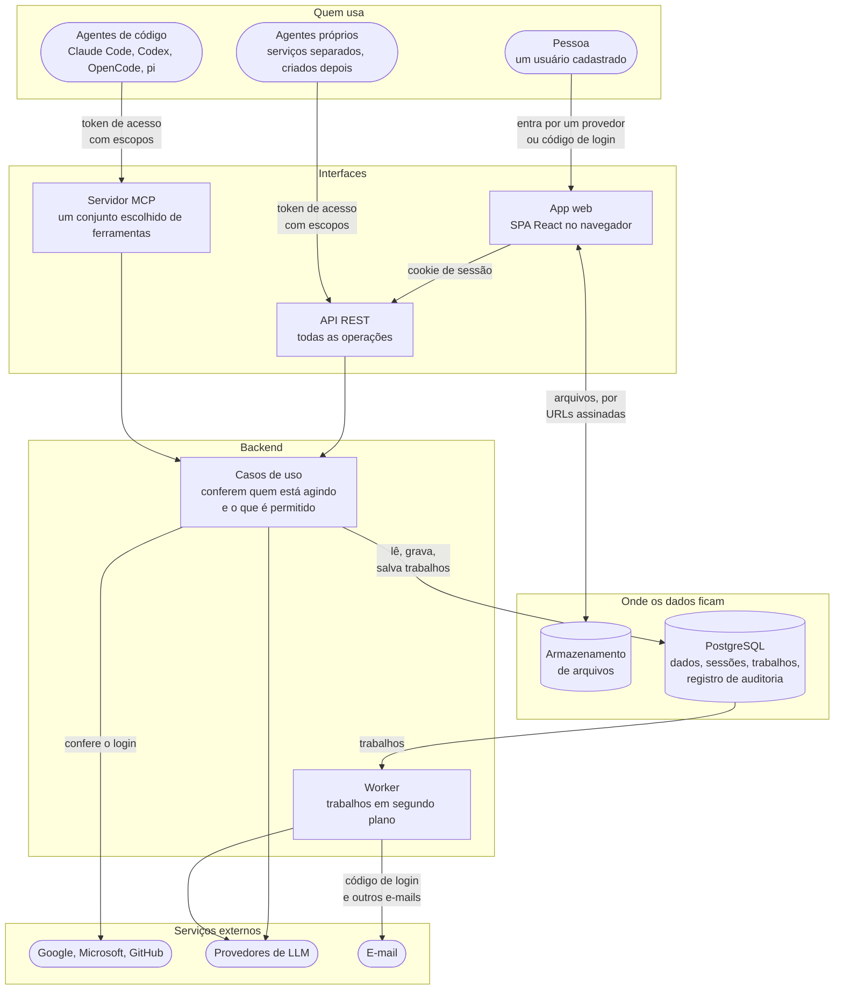
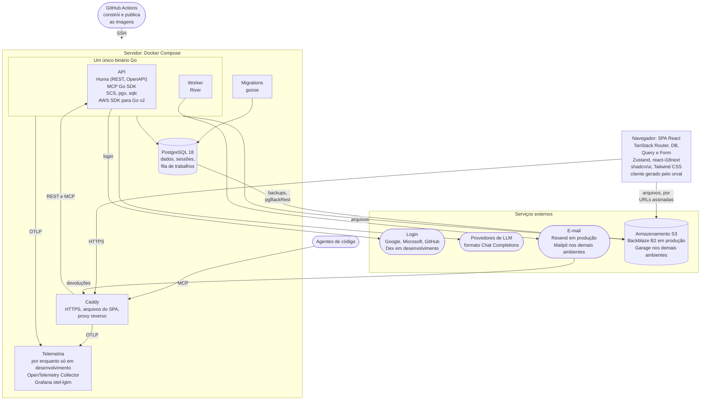

<!-- Versão em português. Mantenha este arquivo sincronizado com o README.md (versão principal). -->

[English](README.md) | **Português**

<picture>
  <source media="(prefers-color-scheme: dark)" srcset="docs/design/brand/mark-on-dark.svg">
  
</picture>

# My Software Factory Manager

Gerenciador de clientes e projetos: uma plataforma centralizada para gestão de clientes, projetos e demandas de desenvolvimento de software.

> **Status:** a fundação, a configuração inicial e o login estão construídos. Uma instalação nova roda em desenvolvimento e passa pela configuração inicial, com a sua consultoria e o seu primeiro administrador, que então faz login, por um provedor de login ou com um código de login enviado por e-mail, e chega ao shell do app (veja [Ambiente de desenvolvimento](#ambiente-de-desenvolvimento)). As áreas de trabalho, como clientes e projetos, e tudo o que vem depois delas ainda não foram construídas; as seções marcadas como _A definir_ são preenchidas conforme o projeto avança.

## Sumário

- [Sobre o projeto](#sobre-o-projeto)
- [Arquitetura](#arquitetura)
- [Tecnologias](#tecnologias)
- [Build e deploy](#build-e-deploy)
- [Backup e manutenção](#backup-e-manutenção)
- [Documentação](#documentação)
- [Licença](#licença)

## Sobre o projeto

### Objetivo

O objetivo é criar uma plataforma centralizada para gestão de clientes, projetos e demandas de desenvolvimento de software, funcionando como o centro operacional de uma consultoria.

A ideia é ter um ambiente para administrar todo o ciclo de vida de um cliente e seus projetos, desde o primeiro contato e o levantamento de necessidades até a entrega, a validação e a manutenção das soluções.

Mais do que um simples gerenciador de tarefas, o sistema deve funcionar como uma espécie de escritório digital inteligente, organizando as informações, os documentos, a comunicação, as demandas e as atividades de cada projeto.

### Problema que resolve

_A definir._

<!-- Descreva a dor atual: onde as informações de clientes e projetos ficam hoje, o que se perde ou se duplica, e quem sofre com isso. -->

### Quem usa e como



Três tipos de consumidor chegam ao sistema, cada um pela sua interface:

- **Uma pessoa** usa o app web no navegador. Ela entra pelo Google, pela Microsoft ou pelo GitHub, ou com um código de login enviado por e-mail, e só entra quem é usuário cadastrado.
- **Agentes de código** usam o servidor MCP, que oferece um conjunto escolhido de ferramentas: atualizar o status de um projeto, consultar clientes e horas, buscar uma credencial.
- **Agentes próprios**, criados depois como serviços separados, usam a API REST.

Um agente entra com um token de acesso que um usuário criou para ele, limitado por escopos, e o que ele faz fica registrado como ação desse usuário. Todas as interfaces terminam nos mesmos casos de uso, que decidem se a ação é permitida, então as regras são as mesmas para qualquer consumidor.

Os dados são lidos e gravados no PostgreSQL. Os arquivos vão direto do navegador para o armazenamento e de volta, por URLs assinadas emitidas pela API. O que ninguém espera na tela é salvo como um trabalho e executado pelo worker: envio de e-mail, processamento de arquivos e chamadas a provedores de LLM.

Um usuário tem papéis: o administrador e o desenvolvedor existem desde a configuração inicial (veja o [ADR-0026](docs/adr/0026-a-role-is-a-record-that-grants-scopes-fixed-in-the-code.md)). O que cada papel pode fazer, os seus escopos, chega com as áreas que os verificam.

## Arquitetura

### Visão geral

Decidido até aqui (veja os ADRs abaixo):



O worker executa os trabalhos em segundo plano que a API grava no PostgreSQL: envio de e-mail, processamento de arquivos e chamadas a provedores de LLM que ninguém espera na tela. O navegador envia e baixa arquivos direto do armazenamento, com URLs assinadas emitidas pela API.

Em produção os arquivos ficam no Backblaze B2. Em desenvolvimento e na homologação ficam no Garage, atrás de um endereço do Caddy.

A telemetria passa pelo coletor: traces e métricas da API, do worker e do Caddy, a saída de todos os containers e as métricas do servidor, do PostgreSQL e do armazenamento. Ele repassa tudo ao Grafana otel-lgtm, que guarda por 30 dias e envia os alertas por e-mail. O Grafana tem um endereço próprio atrás do Caddy, com login pelo GitHub. Por enquanto os dois containers de telemetria rodam só em desenvolvimento: a produção passa a tê-los quando alguém além do mantenedor usar o sistema, e até lá um monitor hospedado fora do servidor a vigia.

O sistema roda em três ambientes: desenvolvimento na máquina do mantenedor, homologação (staging) em um servidor ligado à mão para experimentar um pull request e desligado depois, e produção em um servidor sempre ligado.

Frontend e backend ficam neste único repositório:

```
.
├── apps/
│   ├── api/          # backend e API em Go
│   └── web/          # o app React, com o design system em src/ui
├── deploy/           # Caddyfiles, arquivos Compose dos servidores, cloud-init
├── .github/          # workflows da pipeline
├── docs/
│   ├── adr/          # decisões de arquitetura
│   ├── agents/       # configuração para agentes de IA
│   └── design/       # análise das referências visuais
├── .scratch/         # issues locais
├── compose.yaml      # desenvolvimento
└── Taskfile.yml
```

`apps/web` é o único pacote JavaScript, executado pelo Vite+. Ele tem o próprio `package.json`, catálogo e lockfile, e a raiz não tem nenhum. Um Taskfile na raiz coordena as tarefas de Go e de frontend: desenvolvimento, build, testes e geração de código. Não é usado orquestrador de monorepo à parte.

As telas são construídas direto no app, sobre o design system, sem protótipo antes. O design system está escrito em [`DESIGN.md`](DESIGN.md), que é a referência para todas as telas, e os componentes ficam em `apps/web/src/ui`.

O sistema é multilíngue: inglês é a língua padrão, com suporte também a português do Brasil e espanhol, e cada usuário escolhe a sua. Adicionar uma língua é uma mudança pequena de código, sem alterar a estrutura do banco de dados.

<!-- Descreva a responsabilidade de cada componente e como eles se comunicam. Atualize o diagrama quando a arquitetura for confirmada. -->

### Decisões de arquitetura

As decisões relevantes e difíceis de reverter são registradas como ADRs (Architecture Decision Records) em `docs/adr/`, um arquivo por decisão. Este README traz apenas a visão geral e o índice abaixo.

- [0001 - Go no backend](docs/adr/0001-go-for-the-backend.md): Go em vez de TypeScript e Rust, porque agentes escrevem o código e o ciclo de build precisa ser curto
- [0002 - React como SPA, sem framework full-stack](docs/adr/0002-react-spa-without-a-full-stack-framework.md): Vite+ e TanStack Router atrás do Caddy, sem Next.js nem TanStack Start
- [0003 - Contrato OpenAPI gerado do Go](docs/adr/0003-openapi-contract-generated-from-go.md): os tipos Go são a fonte da verdade da API REST, via Huma
- [0004 - Provedores de LLM e agentes via HTTP](docs/adr/0004-llm-providers-and-agents-over-http.md): uma interface interna para os provedores; agentes são serviços separados que agem apenas pela API
- [0005 - Multilíngue desde o início](docs/adr/0005-multilingual-from-the-start.md): inglês, português do Brasil e espanhol; o front traduz os códigos de erro da API; conteúdo de configuração tem uma versão por língua, texto livre é traduzido sob demanda
- [0006 - Design system validado em um protótipo descartável](docs/adr/0006-design-system-proven-in-a-disposable-prototype.md): shadcn/ui em `packages/ui`, compartilhado pelo produto e por um protótipo clicável; substituído pelo ADR-0025, que mantém o shadcn/ui; o estilo é o do monday.com desde o ADR-0027
- [0007 - Backend organizado por área de domínio](docs/adr/0007-backend-organized-by-domain-area.md): uma árvore de pacotes por área de domínio com dependências apontando para dentro, um caso de uso para cada operação, DDD tático seletivo e parte do object calisthenics
- [0008 - Casos de uso atendidos por vários adaptadores de entrada](docs/adr/0008-use-cases-served-by-several-inbound-adapters.md): uma API REST completa e um servidor MCP com um conjunto escolhido de ferramentas, ambos no backend Go; tokens de acesso com escopos; GraphQL, gRPC e WebSocket adiados
- [0009 - Convenções da API REST](docs/adr/0009-rest-api-conventions.md): snake_case, operações nomeadas sem PATCH, entrada estrita, erros em problem+json, paginação por cursor, sem versionamento enquanto todo consumidor sair junto com o backend
- [0010 - Identificadores sequenciais expostos via Sqids](docs/adr/0010-sequential-identifiers-exposed-through-sqids.md): inteiros por dentro, prefixo de tipo mais codificação Sqids por fora (`prj_Xk9fQ2mB`), com alfabetos fixos no código
- [0011 - Login por provedores externos ou por código de login](docs/adr/0011-login-through-external-providers-with-a-server-side-session.md): Google, Microsoft e GitHub, ou um código de seis dígitos enviado por e-mail; sessão no servidor atrás de um cookie opaco, apenas usuários cadastrados
- [0012 - OpenTelemetry e um registro de auditoria separado](docs/adr/0012-opentelemetry-for-observability-and-a-separate-audit-log.md): traces e métricas enviados por um coletor a um container Grafana, logs lidos da saída dos containers, alertas por e-mail; operações sensíveis gravadas em um registro de auditoria somente de acréscimo
- [0013 - Dados do frontend em coleções e consultas por cursor](docs/adr/0013-frontend-data-in-collections-and-cursor-queries.md): TanStack DB para conjuntos limitados, TanStack Query com o cursor da API para o resto, Zustand só para estado de interface, cliente e schemas Zod gerados pelo orval, TanStack Form
- [0014 - Frontend organizado por área de domínio](docs/adr/0014-frontend-organized-by-domain-area-and-tested-through-screens.md): uma pasta por área de domínio com um módulo de dados que é o único a chamar a API; os testes renderizam telas inteiras em um navegador real com a API simulada
- [0015 - SQL escrito à mão e verificado pelo sqlc, e migrations só para frente](docs/adr/0015-hand-written-sql-checked-by-sqlc-and-forward-only-migrations.md): pgx e sqlc, migrations do goose sem caminho de volta aplicadas em um passo próprio, três usuários do banco, PostgreSQL como único banco de dados, sem cache e sem pool de conexões externo
- [0016 - Trabalhos em segundo plano no PostgreSQL, executados por um comando worker](docs/adr/0016-background-jobs-in-postgresql-run-by-a-worker-command.md): River, o trabalho gravado na transação do seu caso de uso, um comando `worker` do mesmo binário, poucas tentativas e depois uma falha visível
- [0017 - Arquivos no Garage, acessados direto pelo navegador](docs/adr/0017-files-in-garage-reached-directly-by-the-browser.md): Garage no lugar do MinIO, apenas a API S3 pelo AWS SDK para Go v2, uploads e downloads com URLs assinadas de curta duração
- [0018 - Valores de credenciais cifrados pela API](docs/adr/0018-credential-values-encrypted-by-the-api.md): AES-256-GCM no binário Go com uma chave vinda da configuração do deploy, nunca no banco; uma credencial em arquivo é guardada do mesmo modo
- [0019 - Três ambientes, com a homologação em um servidor criado sob demanda](docs/adr/0019-three-environments-with-staging-on-a-server-created-on-demand.md): desenvolvimento na máquina, um servidor de homologação ligado e desligado à mão a partir da máquina, que mostra um pull request rotulado e é populado pelo seed a cada publicação, produção em um servidor da Hetzner; o GitHub Actions publica por SSH, com os segredos nos Environments do GitHub
- [0020 - PostgreSQL com backup pelo pgBackRest, e arquivos de produção no Backblaze B2](docs/adr/0020-postgresql-backed-up-by-pgbackrest-and-production-files-in-backblaze-b2.md): backups contínuos e cifrados em outro provedor, com um teste mensal de restauração, e os arquivos de produção em um bucket com versionamento; o Garage continua em desenvolvimento e na homologação
- [0021 - Um repositório público sob a AGPLv3](docs/adr/0021-a-public-repository-under-agplv3.md): público no plano gratuito do GitHub, com as regras que isso impõe aos commits e à pipeline
- [0022 - Um registro com ciclo de vida é uma máquina de estados no domínio](docs/adr/0022-a-record-with-a-lifecycle-is-a-state-machine-in-the-domain.md): um conjunto fixo de status e uma tabela de transições por agregado, em Go puro; as ações permitidas saem da mesma tabela, e só o nome de um status é conteúdo de configuração
- [0023 - Uma release dá nome a um marco que já está em produção](docs/adr/0023-a-release-names-a-milestone-already-in-production.md): uma versão para o sistema inteiro em um arquivo `VERSION`; uma release é um pull request que muda esse arquivo e o `CHANGELOG.md`, e a pipeline cria a tag depois da publicação
- [0024 - O primeiro administrador é criado em uma configuração inicial aberta por um código de configuração](docs/adr/0024-the-first-administrator-is-created-in-a-setup-opened-by-a-setup-code.md): uma instalação nova não tem usuário; um código de configuração emitido por um comando no servidor abre a configuração inicial, que registra a consultoria e o primeiro administrador de uma vez
- [0025 - O design system fica no produto, e não há protótipo](docs/adr/0025-the-design-system-lives-in-the-product-and-there-is-no-prototype.md): o protótipo, o pacote compartilhado e a galeria são removidos; uma tela é construída direto em `apps/web`, que guarda os componentes e é o único pacote JavaScript
- [0026 - Um papel é um registro que concede escopos fixos no código](docs/adr/0026-a-role-is-a-record-that-grants-scopes-fixed-in-the-code.md): a consultoria cria seus próprios papéis a partir de uma lista de escopos fixa no código; um usuário pode ter vários, uma sessão age com os escopos dos papéis do seu usuário, e o papel de administrador sempre concede todos os escopos
- [0027 - O estilo segue o monday.com, ajustado ao WCAG AA](docs/adr/0027-the-style-follows-monday-com-adjusted-to-wcag-aa.md): os valores do Vibe, o design system do monday.com, no lugar dos do Zed: uma moldura azul-acinzentada com uma área de trabalho branca, Figtree e Poppins, status como rótulos preenchidos e linhas em grupos coloridos, cada par medido contra o WCAG AA

## Tecnologias

| Tecnologia | Papel no projeto |
| --- | --- |
| [Go](https://go.dev/) | Backend e API |
| [Huma](https://huma.rocks/) | Framework HTTP que gera a especificação OpenAPI a partir dos tipos Go |
| [MCP Go SDK](https://github.com/modelcontextprotocol/go-sdk) | Servidor MCP dentro do backend, pelo qual agentes de código operam o sistema |
| [Sqids](https://sqids.org/go) | Identificadores públicos curtos, codificados a partir dos sequenciais internos |
| [SCS](https://github.com/alexedwards/scs) | Sessões no servidor, guardadas no PostgreSQL |
| [env](https://github.com/caarlos0/env) | Lê a configuração das variáveis de ambiente para uma única struct tipada |
| [pgx](https://github.com/jackc/pgx) | Driver do PostgreSQL e o pool de conexões dentro da API |
| [sqlc](https://sqlc.dev/) | Gera código Go tipado a partir de SQL escrito à mão |
| [goose](https://github.com/pressly/goose) | Aplica as migrations do banco, só para frente |
| [pgtestdb](https://github.com/peterldowns/pgtestdb) | Dá a cada teste de banco o seu próprio banco temporário |
| [testify](https://github.com/stretchr/testify) | Asserções dos testes em Go |
| [River](https://riverqueue.com/) | Trabalhos em segundo plano guardados no PostgreSQL e executados pelo comando `worker`, com um painel web |
| [AWS SDK para Go v2](https://github.com/aws/aws-sdk-go-v2) | Cliente do armazenamento S3; assina as URLs de upload e download |
| [go-mail](https://github.com/wneessen/go-mail) | Envia e-mail por SMTP em desenvolvimento e nos testes |
| [Resend](https://resend.com/) | Envia os e-mails em produção e avisa das devoluções |
| [Mailpit](https://mailpit.axllent.org/) | Container que captura os e-mails enviados em desenvolvimento e nos testes |
| [OpenTelemetry](https://opentelemetry.io/) | Traces e métricas do backend |
| [OpenTelemetry Collector](https://opentelemetry.io/docs/collector/) | Container que reúne traces, métricas e logs de todos os serviços e do servidor |
| [Grafana otel-lgtm](https://grafana.com/docs/opentelemetry/docker-lgtm/) | Um container que guarda e mostra a telemetria e envia os alertas |
| [vacuum](https://quobix.com/vacuum/) e [oasdiff](https://github.com/oasdiff/oasdiff) | Lint das convenções da API e relatório de mudanças incompatíveis na especificação OpenAPI |
| [golangci-lint](https://golangci-lint.run/) e [gofumpt](https://github.com/mvdan/gofumpt) | Linter e formatador do código Go |
| [React](https://react.dev/) | Frontend web (single-page app) |
| [Vite+](https://viteplus.dev/) | Ferramentas do frontend em uma única CLI (`vp`): servidor de desenvolvimento e build (Vite, Rolldown), testes (Vitest), lint (Oxlint), formatação (Oxfmt), além do runtime Node.js e do gerenciador de pacotes |
| [TanStack Router](https://tanstack.com/router) | Roteamento tipado no cliente; filtros e paginação ficam na URL |
| [TanStack DB](https://tanstack.com/db) e [TanStack Query](https://tanstack.com/query) | Dados da API no navegador: coleções para conjuntos pequenos, consultas por cursor para o resto |
| [TanStack Form](https://tanstack.com/form) e [Zod](https://zod.dev/) | Formulários, validados com schemas gerados da especificação OpenAPI |
| [Zustand](https://github.com/pmndrs/zustand) | Estado de interface compartilhado entre telas (tema, painéis) |
| [orval](https://orval.dev/) | Gera o cliente TypeScript, os schemas Zod e respostas simuladas a partir da especificação OpenAPI |
| [React Compiler](https://react.dev/learn/react-compiler) | Memoização automática dos componentes no build |
| [Playwright](https://playwright.dev/) e [MSW](https://mswjs.io/) | Testes de tela em navegador real com a API simulada (pelo Vitest) e testes de ponta a ponta |
| [Knip](https://knip.dev/) | Encontra arquivos, exports e dependências sem uso |
| [dependency-cruiser](https://github.com/sverweij/dependency-cruiser) | Verifica os imports do app contra a sua regra de dependências |
| [Chrome DevTools MCP](https://github.com/ChromeDevTools/chrome-devtools-mcp) | Permite aos agentes de código investigar a performance em um Chrome real |
| [react-i18next](https://react.i18next.com/) | Traduções da interface (inglês, português do Brasil, espanhol) |
| [shadcn/ui](https://ui.shadcn.com/) | Base do design system: o código dos componentes é copiado para `apps/web/src/ui`, sobre os primitivos do [Base UI](https://base-ui.com/) |
| [Tailwind CSS](https://tailwindcss.com/) | Estilos e variáveis de estilo do design system (temas claro e escuro) |
| [PostgreSQL](https://www.postgresql.org/) | Banco de dados relacional (versão 18), o único do sistema |
| [Garage](https://garagehq.deuxfleurs.fr/) | Armazenamento de objetos compatível com S3 (documentos e arquivos) em desenvolvimento e na homologação |
| [Backblaze B2](https://www.backblaze.com/cloud-storage) | Armazenamento de objetos compatível com S3 em produção: os arquivos e os backups do banco |
| [pgBackRest](https://pgbackrest.org/) | Backup contínuo e cifrado do PostgreSQL, com restauração para um ponto no tempo |
| [Dex](https://dexidp.io/) | Container de identidade por trás do provedor de login local, em desenvolvimento e nos testes |
| [Hetzner Cloud](https://www.hetzner.com/cloud) | O servidor de produção e o servidor de homologação criado sob demanda |
| [GitHub Actions](https://docs.github.com/actions) | A pipeline: verificações em cada pull request, publicação e testes agendados |
| [GitHub CLI](https://cli.github.com/) | Como os agentes acessam o GitHub: pull requests, execuções e segredos; e como ligar e desligar a homologação grava no Environment do GitHub da homologação |
| [Caddy](https://caddyserver.com/) | HTTPS, arquivos estáticos do frontend, proxy reverso para a API, cabeçalhos de segurança e o limite do código de login e do código de configuração |
| [Docker](https://www.docker.com/) | Empacotamento e execução dos serviços em containers (Docker Compose) |
| [Task](https://taskfile.dev/) | Executor de tarefas do repositório (desenvolvimento, build, testes, geração de código) |
| [pnpm](https://pnpm.io/) | Gerenciador de pacotes do frontend, instalado e executado pelo Vite+ |

<!-- Inclua novas tecnologias nesta tabela à medida que forem adotadas. -->

## Build e deploy

### Pré-requisitos

| Ferramenta | Versão mínima | Onde obter |
| --- | --- | --- |
| Docker | Engine 28.3.2 com Compose 2.38.2 (Docker Desktop 4.43.2) | [Docker Desktop](https://docs.docker.com/desktop/), ou o Docker Engine com o plugin do Compose no Linux |
| Go | 1.27.4 | [go.dev/dl](https://go.dev/dl/) |
| Vite+ (gerencia Node.js e pnpm) | 1.6.0 | [viteplus.dev](https://viteplus.dev/) |
| Task | 3.54.0 | [taskfile.dev](https://taskfile.dev/installation/) |
| GitHub CLI | 2.104.0 | [cli.github.com](https://cli.github.com/). Para abrir pull requests e consultar a pipeline, e para ligar e desligar a homologação, logado como o mantenedor (`gh auth login`) com o token cujas permissões estão no [`docs/providers.md`](docs/providers.md#github) |

Cada mínimo é a versão em uso na máquina do mantenedor, registrada em [`docs/machine-tools.yaml`](docs/machine-tools.yaml). Nenhuma versão anterior foi testada. O Git clona o repositório.

O desenvolvimento ocupa nove portas da máquina: 80 (Caddy), 5432 (PostgreSQL), 3900 (Garage), 1025 e 8025 (Mailpit), 5556 (Dex), 8081 (o painel do River), 8080 (a API) e 5173 (Vite). Um `.env` muda todas menos as duas últimas (veja abaixo); o Caddy encaminha para essas duas.

O Go instalado só baixa o toolchain que o `go.mod` indica. Todas as outras versões usadas pelo build são fixadas no repositório (veja Versions em [`CODING_STANDARDS.md`](CODING_STANDARDS.md)).

### Configuração

O binário da API lê a configuração apenas de variáveis de ambiente, uma única vez, ao iniciar. Um valor ausente ou inválido encerra o processo antes de ele atender qualquer coisa, com uma linha que cita a variável e nunca o valor. O binário não lê `.env` nem arquivo de configuração: o Task e o Compose carregam as variáveis.

Toda variável está listada no `.env.example` versionado, sem segredos reais.

A ferramenta que liga e desliga a homologação lê duas variáveis que não estão lá, porque elas pertencem à máquina do mantenedor e nenhum servidor e nenhuma publicação as lê dali: `HETZNER_TOKEN`, o token de API do projeto de homologação na Hetzner, que nunca chega a um servidor nem ao GitHub, e `STAGING_MAILPIT_PASSWORD`, a senha do Mailpit da homologação. As duas ficam no `.env` do checkout principal, que a ferramenta lê também quando roda em uma worktree. O token é escrito ali pelo mantenedor; a senha, pela ferramenta, na primeira vez que a homologação é ligada (veja Deploy).

| Ambiente | Onde ficam os valores |
| --- | --- |
| Desenvolvimento | O `.env.example`, cujos valores funcionam como estão. Um arquivo `.env`, nunca versionado, altera um valor: o Task o lê primeiro |
| Homologação | A publicação da ferramenta dos ambientes, que decide um valor para cada nome do `.env.example` em `apps/api/tools/environment/variables.go`: fixo, derivado da publicação (o endereço do servidor, o commit, a senha do Mailpit), sorteado a cada publicação ou deliberadamente vazio. Ela os grava em um arquivo de variáveis no servidor, que só o usuário de deploy consegue ler. O Environment `staging` do GitHub guarda só o que chega ao servidor |
| Produção | O Environment `production` do GitHub: um segredo para o que é secreto, uma variável para o restante. A publicação os grava em um arquivo de variáveis no servidor, que só o usuário de deploy consegue ler |

Uma variável nova recebe o valor da homologação, decidido em `apps/api/tools/environment/variables.go`, e o valor de produção, definido no Environment `production` do GitHub, antes do merge. A publicação compara os nomes do `.env.example` com os valores que tem e para, antes de entrar no servidor, quando falta algum.

Cada comando do binário exige apenas as variáveis que usa. As que o binário lê hoje:

| Variável | O que é | Padrão |
| --- | --- | --- |
| `API_LISTEN_ADDRESS` | Onde a API escuta, no formato `host:porta`. Um host vazio significa todas as interfaces | Nenhum: a API exige |
| `SHUTDOWN_DRAIN_DEADLINE` | Quanto tempo as requisições em andamento têm para terminar depois que a API recebe a ordem de parar | `20s` |
| `LOG_LEVEL` | O menor nível que o binário registra nos logs: `debug`, `info`, `warn` ou `error` | `info` |
| `OTEL_EXPORTER_OTLP_ENDPOINT` | URL base do receptor OTLP/HTTP para onde os traces são exportados, como `http://localhost:4318`. Vazia, nada é exportado | Vazio |
| `DATABASE_URL` | URL de conexão do papel da API, que lê e grava linhas | Nenhum: a API, o `issue-setup-code` e o `worker` exigem |
| `MIGRATION_DATABASE_URL` | URL de conexão do papel de migração, que é dono das tabelas | Nenhum: o `migrate` exige |
| `DATABASE_POOL_MAX_SIZE` | O máximo de conexões que o pool da API abre | `10` |
| `DATABASE_STATEMENT_TIMEOUT` | Por quanto tempo um comando SQL pode rodar | `30s` |
| `DATABASE_IDLE_IN_TRANSACTION_TIMEOUT` | Por quanto tempo uma transação pode ficar ociosa | `1m` |
| `HEALTH_CHECK_TIMEOUT` | Quanto tempo a verificação de uma parte pode levar, incluída a de prontidão | `2s` |
| `APP_ORIGIN` | O endereço em que as pessoas abrem o app: esquema, host e, se houver, porta, sem nada depois. O `issue-setup-code` monta com ele o endereço da configuração inicial, e a API só envia o cookie da sessão por HTTPS quando ele é `https`, e recusa um pedido que muda o estado com esse cookie vindo de qualquer outra origem | Nenhum: a API e o `issue-setup-code` exigem |
| `FILE_STORAGE_URL` | A origem em que a API alcança a API S3 do armazenamento de arquivos | Nenhum: a API e o `worker` exigem |
| `FILE_STORAGE_PUBLIC_URL` | A origem em que o navegador alcança o armazenamento de arquivos. Uma URL assinada é assinada para o nome de host dela | Nenhum: a API e o `worker` exigem |
| `FILE_STORAGE_REGION` | A região com que o armazenamento de arquivos assina | Nenhum: a API e o `worker` exigem |
| `FILE_STORAGE_BUCKET` | O único bucket privado dos arquivos | Nenhum: a API e o `worker` exigem |
| `FILE_STORAGE_ACCESS_KEY_ID` | A chave com que a API assina para o armazenamento de arquivos | Nenhum: a API e o `worker` exigem |
| `FILE_STORAGE_SECRET_ACCESS_KEY` | O segredo dessa chave. É um segredo e nunca é impresso | Nenhum: a API e o `worker` exigem |
| `LOGIN_CODE_KEY` | A chave com que os códigos de login são calculados: pelo menos 32 bytes em hexadecimal, como o `openssl rand -hex 32` os escreve. É um segredo, e nunca é impressa. Trocá-la encerra só os códigos ainda não usados | Nenhum: a API e o `worker` exigem. O `.env.example` traz uma para o desenvolvimento |
| `SEED_MAILBOX` | A caixa de e-mail de que os endereços do seed derivam: o administrador é o endereço dela com a etiqueta `+admin`, o desenvolvedor com `+developer`. Lida pelo binário do seed, não pela API | Nenhum: o `seed` exige. O `.env.example` traz uma fictícia |
| `WORKER_LIGHT_QUEUE_MAX_JOBS` | O máximo de trabalhos da fila leve, como enviar um e-mail, que um worker executa ao mesmo tempo | `10` |
| `WORKER_HEAVY_QUEUE_MAX_JOBS` | O máximo de trabalhos da fila pesada, como converter um arquivo, que um worker executa ao mesmo tempo | `2` |
| `WORKER_SHUTDOWN_DEADLINE` | Quanto tempo os trabalhos em execução têm para terminar depois que o worker recebe a ordem de parar, antes de serem cancelados e deixados para o próximo worker | `20s` |
| `EMAIL_SENDER` | Por onde o worker envia e-mail: `smtp`, um servidor SMTP, ou `resend`, a API do Resend, em produção | Nenhum: o `worker` exige |
| `EMAIL_SMTP_ADDRESS` | O servidor SMTP, como `host:porta` com um host: o Mailpit fora da produção | Nenhum: o `worker` exige enquanto `EMAIL_SENDER` for `smtp` |
| `EMAIL_FROM_ADDRESS` | O endereço de que todo e-mail é enviado | Nenhum: o `worker` exige. O `.env.example` traz um fictício |
| `EMAIL_FROM_NAME` | O nome de que todo e-mail é enviado | Nenhum: o `worker` exige. O `.env.example` traz um fictício |
| `RESEND_API_KEY` | A chave da conta do Resend. É um segredo e nunca é impressa | Nenhum: o `worker` exige enquanto `EMAIL_SENDER` for `resend` |
| `RESEND_WEBHOOK_SECRET` | O segredo de assinatura do webhook pelo qual o Resend avisa de uma devolução, como o Resend o mostra: `whsec_` seguido da chave em base64. Com ele, a API recebe os avisos em `/api/resend/bounces`, o endereço a cadastrar no Resend para o evento `email.bounced`; sem ele, esse caminho é desconhecido | Vazio: nenhum webhook |
| `LOCAL_LOGIN_PROVIDER_KEY` | A chave do provedor de login local, um provedor OpenID Connect para o desenvolvimento e os testes: ela nomeia o provedor nos caminhos do login por ele (`/api/session/login_providers/<chave>/...`), nos seus vínculos com o provedor e, como forma de entrada, no registro de auditoria. Letras minúsculas, dígitos e sublinhados, começando por uma letra, 64 no máximo | Vazio: o provedor de login local fica desligado |
| `LOCAL_LOGIN_PROVIDER_DISPLAY_NAME` | O nome que a tela de login mostra no botão do provedor de login local | Vazio: desligado |
| `LOCAL_LOGIN_PROVIDER_ISSUER_URL` | O emissor do provedor de login local, cujo documento de descoberta a API lê no primeiro login por ele. O navegador e a API o alcançam nesse mesmo endereço | Vazio: desligado |
| `LOCAL_LOGIN_PROVIDER_CLIENT_ID` | O cliente que o sistema é no provedor de login local | Vazio: desligado |
| `LOCAL_LOGIN_PROVIDER_CLIENT_SECRET` | O segredo desse cliente. É um segredo, e nunca é impresso | Vazio: desligado |

As cinco variáveis `LOCAL_LOGIN_PROVIDER_` ligam o provedor de login local juntas, e a API se recusa a iniciar com umas preenchidas e outras vazias; quando ele está ligado, uma linha do log dela o nomeia ao iniciar. O endereço de retorno registrado para o cliente é a origem do app seguida de `/api/session/login_providers/<chave>/callback`. O `.env.example` o liga, apontado para o container do Dex do desenvolvimento; homologação e produção deixam as cinco vazias e fazem o login pelos provedores de login reais.

O `.env.example` também guarda o que só o desenvolvimento usa: a porta e as senhas do container do PostgreSQL, a porta do Caddy, a porta do Garage e o segredo que os nós dele compartilham, as duas portas do Mailpit, a porta do Dex, a porta do painel do River, a interface em que o Vite escuta, a conexão com que os testes em Go criam seus bancos temporários e a `RESEND_TEST_API_KEY`, a chave dos testes contra o Resend, vazia ali. O Garage cria o seu bucket e a sua chave a partir das variáveis `FILE_STORAGE_`.

As variáveis do que ainda não foi construído (Google, Microsoft e GitHub como provedores de login, e as demais) estão _A definir_, e cada uma entra com o código que a lê.

### Ambiente de desenvolvimento

Go, Vite+ e Task rodam na máquina, então um teste roda sem passar pelo Docker. `task dev` roda a API, o worker e o Vite. O `compose.yaml` da raiz roda os serviços com que eles conversam:

| Serviço | Em desenvolvimento |
| --- | --- |
| Proxy reverso | Caddy |
| Banco de dados | PostgreSQL |
| Armazenamento de arquivos | Garage |
| Trabalhos em segundo plano | O painel do River, que mostra os trabalhos e as suas filas |
| E-mail | Mailpit, que captura o que é enviado |
| Login | Dex como provedor local, ou um código de login lido no Mailpit |
| Provedor de LLM | Um substituto escrito neste repositório, com respostas fixas |
| Telemetria | O OpenTelemetry Collector e o Grafana otel-lgtm, em um perfil do Compose desligado por padrão |

O seed preenche o banco com dados fictícios, os mesmos a cada execução. Para trabalhar em um prompt com um provedor de LLM real, altere o `.env` local.

A pipeline chama os mesmos alvos do Task, então uma verificação que falha nela falha do mesmo jeito na máquina.

Da tabela acima, o PostgreSQL, o Garage, o Mailpit, o Dex, o painel do River e o Caddy são o que roda hoje, ao lado da API, do worker e do app. De uma máquina limpa até a configuração inicial concluída, com os pré-requisitos instalados e o Docker em execução:

1. Clone o repositório com o Git e abra um terminal na raiz dele. Todos os comandos abaixo rodam ali.
2. `task install`. Na primeira vez, ele baixa o Node.js, o pnpm, as dependências JavaScript e o Chromium dos testes, cerca de 330 MB.
3. `task services`. Na primeira vez, ele gera a imagem do Caddy, o que leva alguns minutos.
4. `task migrate`. Na primeira vez, o Go baixa os módulos da API e a compila.
5. `task dev`, que inicia a API, o worker e o app juntos. Deixe-o rodando.
6. Em um segundo terminal, `task issue-setup-code`. Ele mostra o código de configuração e o endereço da configuração inicial, `http://localhost/setup`.
7. Abra esse endereço. A primeira carga demora, porque o Vite empacota as dependências do app. Digite o código, preencha a consultoria e o seu primeiro administrador, um logotipo e uma foto se você os tiver, revise o que digitou e conclua.

O app então leva à tela de login, que diz que a configuração inicial foi concluída e que o administrador faz login abaixo: com um código de login, que o Mailpit mostra (veja abaixo), ou pelo Dex quando o e-mail do administrador é um que o Dex conhece. Depois do login o app abre o seu shell, no idioma preferido do usuário: o cabeçalho com o menu dele, que faz o logout, a barra lateral com o nome e o logotipo da consultoria e uma superfície de trabalho que diz que as áreas de trabalho vêm em seguida. `task e2e` percorre o mesmo caminho em um navegador, em um banco e um bucket só dele: a configuração inicial, um login pelo Dex, o logout, um login com um código lido no Mailpit e uma pessoa que o Dex conhece e não é usuário.

Para pular a configuração inicial, rode `task seed` no lugar dos passos 6 e 7. Ele cadastra uma consultoria fictícia, a Fábrica Exemplo, e a sua administradora, Ana Exemplo, pelos mesmos casos de uso que a configuração inicial roda, então os dados obedecem a todas as regras, e o app abre na tela de login. Toda execução em um banco vazio cria os mesmos dados com os mesmos identificadores, e uma execução em um banco cuja configuração inicial foi concluída não altera nada. O e-mail da administradora é a caixa de `SEED_MAILBOX` com a etiqueta `+admin`: `seed+admin@fabrica.example` com o valor do `.env.example`. Nada no seed é real.

O navegador chega a tudo pelo Caddy, em um único endereço, `http://localhost`: o app, e a API em `/api`. O armazenamento de arquivos tem um nome de host próprio, `http://files.localhost`, onde o navegador envia uma imagem para uma URL que a API assinou; o Garage só a aceita vinda da origem do app. Nada é configurado à mão: os valores do `.env.example` funcionam como estão com o Docker Desktop. Com o Docker Engine no Linux, o Caddy só alcança a API e o Vite quando eles escutam em todas as interfaces: escreva `API_LISTEN_ADDRESS=0.0.0.0:8080` e `WEB_LISTEN_HOST=0.0.0.0` em um `.env`. Quando a porta 80 estiver ocupada, mude ali o `CADDY_PORT` e acrescente a porta ao `APP_ORIGIN` e ao `FILE_STORAGE_PUBLIC_URL`.

O worker executa os trabalhos que a API grava, em uma fila leve e uma fila pesada. O primeiro trabalho dele entrega um e-mail: todo e-mail que o sistema envia é um registro, e o trabalho dele o escreve no idioma do destinatário e o envia por SMTP, ou pelo Resend em produção, que avisa a API de uma devolução. Em desenvolvimento o e-mail vai para o Mailpit, que o guarda e não entrega nada: a tela dele, em `http://localhost:8025` (`MAILPIT_PORT`), mostra todo e-mail enviado. O código de login é o primeiro e-mail que o sistema pede: na tela de login, digite o e-mail de um usuário e "Send a code", e o Mailpit mostra o código logo depois, no idioma preferido do usuário; digite os seis dígitos dele na tela. Sem a tela, `curl -i -c cookies.txt -X POST http://localhost/api/session/login_code -H "Content-Type: application/json" -d '{"email":"<o e-mail de um usuário>"}'` responde 202 para qualquer e-mail, e só envia o código quando o e-mail pertence a um usuário ativo. Com o mesmo cookie, `curl -i -b cookies.txt -c cookies.txt -X POST http://localhost/api/session/login_code/check -H "Content-Type: application/json" -d '{"code":"<os seis dígitos>"}'` faz o login do usuário (204), `curl -b cookies.txt http://localhost/api/session` diz quem está logado e `curl -i -b cookies.txt -X POST http://localhost/api/session/log_out` faz o logout. A cada hora, e uma vez ao iniciar, o worker também limpa o armazenamento de arquivos: remove os uploads nunca confirmados um dia depois de iniciados e os objetos com mais de um dia que nenhum arquivo confirmado nomeia. O painel do River mostra os trabalhos do banco de desenvolvimento em `http://localhost:8081` (`RIVER_PANEL_PORT`); ele roda só em desenvolvimento, até a API servi-lo aos administradores.

O provedor de login local é o Dex, em `http://localhost:5556` (`DEX_PORT`), que conhece duas pessoas da seed, com senhas fixas também fictícias:

| E-mail | Senha | No sistema |
| --- | --- | --- |
| `seed+admin@fabrica.example` | `local-provider-admin` | Ana Exemplo, a administradora que a seed cria |
| `seed+developer@fabrica.example` | `local-provider-developer` | Ainda não é usuário: o login é recusado com o aviso de um e-mail sem usuário ativo |

A tela de login mostra um botão para ele, "Entrar com Local login provider", acima do login com um código; o botão, como abrir `http://localhost/api/session/login_providers/local/start` no navegador, leva o navegador à página de login do Dex; quando a pessoa entra ali, o Dex devolve o navegador à API, que faz o login da administradora e volta à raiz do app, ou ao caminho do app em `?return_to=`. O primeiro login pelo Dex encontra o usuário pelo e-mail que o Dex diz verificado e vincula a conta; os seguintes encontram o usuário por esse vínculo. `http://localhost/api/session/login` diz os provedores ligados e, depois de um login recusado, o e-mail dele. O Dex guarda o que precisa na memória, então um login em andamento não sobrevive a um reinício dele; as pessoas que ele conhece estão na configuração dele, no `compose.yaml`. Entrar como o desenvolvedor traz de volta a tela de login com o aviso e o e-mail.

`http://localhost/up` responde com o status da prontidão da API e sem corpo: 503 até as migrations serem aplicadas, e 502 enquanto a API não estiver rodando. A própria API responde à verificação de atividade em `http://127.0.0.1:8080/livez` e à de prontidão em `http://127.0.0.1:8080/readyz`, que o Caddy não encaminha. Em um servidor, o comando `probe-readiness` do binário da API pergunta o mesmo à API do seu container, como verificação de saúde do Compose, já que a imagem não tem shell.

Uma instalação nova não tem usuário nem consultoria. `task issue-setup-code` emite o código de configuração que abre a configuração inicial e mostra, na saída do próprio comando, o código, quando ele deixa de funcionar, o que ele abre e o endereço da configuração inicial. O código vale por uma hora, e um novo encerra o anterior. Só o seu hash é guardado, então um código perdido não pode ser lido de volta: emita outro. Em um servidor, o mesmo comando do binário da API, `issue-setup-code`, roda dentro do container da API. O app recebe o código no endereço da configuração inicial, `/setup`: até a configuração inicial ser concluída, todo endereço do app leva até lá. Depois de concluída, o mesmo comando é o caminho de volta quando nenhum administrador consegue entrar: o código que ele emite abre `/setup` no passo do administrador e cadastra um novo, e nenhum usuário que existe é alterado.

Os comandos, executados na raiz do repositório:

| Comando | O que faz |
| --- | --- |
| `task install` | Instala as dependências JavaScript e o Chromium em que rodam os testes de tela. O Vite+ baixa as versões de Node.js e pnpm que o `apps/web/package.json` indica |
| `task services` | Gera a imagem do Caddy, inicia os serviços de desenvolvimento no Docker (o PostgreSQL, o Garage com o seu bucket, a sua chave e a sua regra de origem cruzada, o Mailpit, o Dex, o painel do River e o Caddy) e espera até ficarem saudáveis. Toda cópia de trabalho do repositório, inclusive um worktree do Git, usa os mesmos containers |
| `task services:stop` | Para os serviços de desenvolvimento e mantém os dados |
| `task migrate` | Aplica as migrations pendentes no banco de desenvolvimento. Uma segunda execução não aplica nada |
| `task issue-setup-code` | Emite um código de configuração no banco de desenvolvimento e o mostra, com quando deixa de funcionar, o que abre e o endereço da configuração inicial |
| `task seed` | Preenche o banco de desenvolvimento com a consultoria fictícia e a sua administradora, pelos casos de uso da configuração inicial, para o app abrir na tela de login. Em um banco cuja configuração inicial foi concluída, não altera nada |
| `task seed:image` | Constrói a imagem do seed, `software-factory-manager-seed:servers`, que o staging executa, e não publica nada. O pipeline a executa em todo pull request |
| `task api:image` | Constrói a imagem da API, `software-factory-manager-api:servers`, que os servidores executam com cada comando do binário, e não publica nada. O pipeline a executa em todo pull request |
| `task caddy:image` | Gera o app web com o `task web:build` e, em seguida, a imagem do Caddy dos servidores com o app dentro, `software-factory-manager-caddy:servers`, e não publica nada. O pipeline a executa em todo pull request |
| `task dev` | Inicia a API, o worker e o Vite juntos. O app abre em `http://localhost`, pelo Caddy |
| `task api` | Inicia só a API, em `http://127.0.0.1:8080` |
| `task worker` | Inicia só o worker, que executa os trabalhos do banco de desenvolvimento. Ele para na hora quando há uma migration pendente |
| `task web` | Inicia só o Vite, na porta 5173, atrás do Caddy |
| `task api:build` | Gera o binário da API em `apps/api/bin` |
| `task web:build` | Gera o app web para os servidores em `apps/web/dist`, com uma cópia Brotli ao lado de cada arquivo de texto |
| `task api:test` | Inicia os serviços e roda os testes em Go. Um teste que precisa do PostgreSQL cria nele o próprio banco temporário; um teste do armazenamento de arquivos grava objetos próprios no bucket do Garage e os remove; um teste do adaptador SMTP envia ao Mailpit, para um endereço só dele, e lê o e-mail de volta pela API do Mailpit; um teste do login por um provedor entra no Dex, conduzindo a página de login dele por HTTP. Os argumentos depois de `--` substituem a lista de pacotes |
| `task api:test:resend` | Roda os testes do adaptador do Resend contra o próprio Resend, enviando aos endereços de teste dele, que não entregam nada, com a chave em `RESEND_TEST_API_KEY`. Sem a chave, eles são pulados. O workflow agendado `resend.yml` os roda todo dia, nunca um pull request |
| `task db:clean` | Apaga os bancos que os testes em Go deixam no PostgreSQL de desenvolvimento, os de nome `test_...` e `testdb_...`: o banco de um teste que falhou ou foi interrompido, e um template do pgtestdb para cada estado que as migrações tiveram. Nenhum outro banco é tocado, nem o `software_factory` nem o `software_factory_e2e`. Rode quando nenhum teste estiver rodando, de vez em quando ou quando a lista de bancos crescer: um banco ainda em uso não é apagado, e o comando para nele |
| `task api:lint` | Roda o lint do código Go e verifica o formato, os imports entre camadas e entre áreas de domínio, o `else` e o nível de aninhamento |
| `task api:format` | Reescreve os arquivos Go como o formatador pede |
| `task versions:check` | Verifica se toda versão fixada no repositório é exata: sem intervalo, sem `latest`, sem tag flutuante |
| `task compose:check` | Verifica o arquivo do Compose de staging com `docker compose config --quiet`, que não imprime nada |
| `task workflows:check` | Verifica os arquivos de workflow com o actionlint e o zizmor, cada um rodado a partir da sua imagem Docker |
| `task api:generate` | Gera, com o sqlc, o código Go dos adaptadores `postgres` a partir dos arquivos SQL de cada um. O resultado entra no commit |
| `task api:generate:check` | Falha quando o código gerado pelo sqlc que está no repositório ficou desatualizado |
| `task api:spec` | Gera a especificação OpenAPI a partir do código Go, em `apps/api/openapi.yaml`. O resultado entra no commit |
| `task api:spec:check` | Falha quando a especificação OpenAPI que está no repositório ficou desatualizada |
| `task api:lists` | Escreve no app os países, as moedas e os fusos horários que a API aceita, em `apps/web/src/shared/places/lists.gen.ts`. O resultado entra no commit |
| `task api:lists:check` | Falha quando as listas do app que estão no repositório não são as que a API aceita |
| `task api:spec:lint` | Roda o lint da especificação OpenAPI do repositório com o vacuum: nomes em `snake_case` e recursos no plural |
| `task api:spec:breaking` | Mostra, com o oasdiff, as mudanças incompatíveis da especificação OpenAPI em relação à `origin/main`. Uma mudança incompatível não o faz falhar; uma falha do próprio oasdiff, como uma revisão que ele não consegue ler, faz. `SPEC_BASE=<revisão>` compara com outra revisão |
| `task web:generate` | Gera, com o orval, o cliente da API do app, os seus schemas Zod e as suas respostas simuladas a partir de `apps/api/openapi.yaml`, em `apps/web/src/shared/api/generated`. O resultado entra no commit |
| `task web:generate:check` | Falha quando o cliente gerado pelo orval que está no repositório ficou desatualizado |
| `task web:imports` | Falha quando um import do app quebra a sua regra de dependências, com o dependency-cruiser |
| `task web:knip` | Falha com um arquivo, um export ou uma dependência do app que nada usa, com o Knip |
| `task e2e` | Roda o teste de ponta a ponta da configuração inicial e do login no Chromium, pelo Caddy, com o Playwright: a configuração inicial, um login pelo Dex, o shell e o logout, um login com um código lido no Mailpit e os limites do Caddy. Ele inicia os serviços, entre eles o Mailpit e o Dex, gera o binário da API, reinicia o Caddy para que os limites comecem vazios, cria vazio o banco `software_factory_e2e` e aplica as migrations, e cria o bucket `software-factory-e2e-files` no Garage na sua primeira execução; o Playwright inicia a API, o worker e o Vite nesse banco e nesse bucket e os encerra no fim. O banco de desenvolvimento e o bucket dele não são tocados. As portas 8080 e 5173 precisam estar livres: pare o `task dev` antes. Um teste que falha deixa o seu trace em `apps/web/test-results`, que o `vp exec playwright show-trace <arquivo>`, rodado em `apps/web`, abre |
| `task check` | Roda todas as verificações de um pull request: as versões exatas, a verificação dos arquivos de workflow, a verificação do cliente gerado, as de formato, lint e tipos de `apps/web`, a sua regra de dependências, o seu código sem uso, as chaves de tradução ausentes e os testes do app e, em seguida, o lint da API, a verificação do código gerado, a verificação da especificação OpenAPI, a verificação das listas do app, o lint e o relatório de mudanças incompatíveis da especificação, o build da API, o build do app web e as três imagens com que um commit é publicado, os testes da API, e o teste de ponta a ponta. Por causa do teste de ponta a ponta, precisa das portas 8080 e 5173 livres e reinicia o Caddy: pare o `task dev` antes |
| `task check:quick` | Roda tudo o que o `task check` roda, menos o teste de ponta a ponta, para o uso do dia a dia. Não precisa de porta livre nem reinicia o Caddy, então roda ao lado do `task dev`. Antes de um pull request, rode o `task check` |
| `task check:fix` | Roda as verificações de formato, lint e tipos de `apps/web` e corrige o que for possível |

O sqlc roda com `go tool`, a partir de um arquivo de módulo só dele, `apps/api/sqlc.mod`. Na primeira vez em uma máquina, o Go baixa e compila o sqlc, o que leva vários minutos: uma das dependências dele tem mais de cem mil arquivos, e extraí-los no Windows chega a levar meia hora. O comando parece parado nesse tempo. Não o interrompa, porque a extração recomeça do zero. O vacuum e o oasdiff rodam do mesmo jeito, a partir de `apps/api/vacuum.mod` e `apps/api/oasdiff.mod`, e cada um é compilado em alguns minutos na primeira vez. O mesmo vale para a CLI do River, a partir de `apps/api/river.mod`, que exporta o SQL das tabelas do River para uma migration: `go tool -modfile=river.mod river migrate-get --line main --version <n> --up`, rodado em `apps/api` (veja Jobs no [`CODING_STANDARDS.md`](CODING_STANDARDS.md)).

O contrato REST é o arquivo `apps/api/openapi.yaml`. Ele é gerado a partir das operações que a API serve; por isso, depois de alterar uma delas, rode `task api:spec` e inclua o arquivo no commit junto com o código.

### Build

- **Backend.** Um binário Go, em uma imagem: a API e os comandos `worker`, `migrate`, `issue-setup-code` e `probe-readiness`. As migrations vão embutidas nele.
- **Seed e substituto do provedor de LLM.** Cada um é um pacote `main` próprio no mesmo módulo Go, com a própria imagem. A produção não roda nenhum dos dois.
- **Frontend.** O Vite+ gera os arquivos estáticos de `apps/web`, com uma cópia Brotli ao lado de cada arquivo de texto. O Caddy os serve.
- **Caddy e PostgreSQL.** As duas imagens são construídas neste repositório: a do Caddy com um plugin de limite de requisições e, nos servidores, com o app web gerado dentro; a do PostgreSQL com o pgBackRest.
- **Código gerado.** A pipeline verifica se ele está atualizado: o código Go que o sqlc gera a partir dos arquivos SQL, a especificação OpenAPI gerada a partir do código Go e o cliente que o orval gera a partir dessa especificação.
- **Versões.** O build instala a partir do `go.sum` e do `pnpm-lock.yaml` e falha quando eles mudariam.
- **Imagens.** O GitHub Actions as constrói, marca cada uma com o hash do commit e envia para o registro de containers do GitHub. A produção só roda imagem construída a partir da `main`. As imagens de uma release levam também o número dela.

O `task api:build` gera o binário da API em `apps/api/bin`. A imagem do seed é construída a partir de `apps/api/cmd/seed/Dockerfile` pelo serviço `seed` do `compose.yaml`, que fica em um perfil próprio do Compose para que o `task services` não o inicie: `docker compose --profile seed run --rm --build seed` a constrói e a roda no banco de desenvolvimento. O `task api:image` constrói a imagem da API a partir de `apps/api/cmd/api/Dockerfile`, e o `task caddy:image` gera o app web, com o `task web:build`, e depois o estágio `servers` de `deploy/caddy/Dockerfile`, com a saída do build como contexto; o desenvolvimento constrói o estágio `development` do mesmo arquivo, que não tem o app. As três são construídas em todo pull request e não são publicadas em lugar nenhum. Os outros comandos estão _A definir_, e cada um será escrito com o que ele constrói.

### Deploy

Toda mudança chega à `main` por um pull request, e um merge na `main` é publicado em produção assim que a pipeline passa. O GitHub Actions constrói as imagens, envia para o registro de containers do GitHub e entra no servidor por SSH para baixá-las e reiniciar os serviços do Compose. Os segredos de cada ambiente ficam nos Environments do GitHub, e a publicação os grava em um arquivo de variáveis no servidor (veja o [ADR-0019](docs/adr/0019-three-environments-with-staging-on-a-server-created-on-demand.md)).

A homologação é um servidor que só existe enquanto um pull request é experimentado nele, e só custa enquanto está ligada (veja o [`docs/providers.md`](docs/providers.md)). Ela é ligada e desligada à mão, do checkout principal ou de uma worktree dele:

```sh
task staging:on      # cria o servidor, espera até ele ficar pronto e dá ao GitHub o que chega até ele
task staging:status  # ligada ou desligada, desde quando, o endereço, os nomes de host e o pull request com o rótulo
task staging:off     # destrói o servidor, com o endereço e a chave de deploy, e os tira do GitHub
```

A máquina precisa do `HETZNER_TOKEN` no `.env` do checkout principal: um token de API do projeto `software-factory-manager-staging` da Hetzner, com permissão de leitura e escrita. Ela também precisa do `gh` logado como o mantenedor, com as permissões que a linha "Token of `gh` on the maintainer's machine" dá, na seção GitHub do [`docs/providers.md`](docs/providers.md#github). O `task staging:on` garante que o Environment `staging` do GitHub e o rótulo `staging` existem, cria o servidor com as escolhas do `deploy/server.staging.yaml`, preparado pelo `deploy/cloud-init.yaml`, e termina quando o servidor responde ao SSH com a chave de host que recebeu, o cloud-init o preparou e o Environment `staging` do GitHub tem o que a pipeline precisa para chegar até ele: o endereço, a chave de host e a chave de deploy do servidor, e a senha do Mailpit. Quando isso falha, ele destrói o servidor e tira esses valores do GitHub antes de relatar a falha. Ligar a homologação quando ela está ligada não cria nada e dá ao GitHub os mesmos valores de novo; desligá-la quando está desligada não destrói nada. Nada a desliga sozinho: quando ela fica ligada por mais de 24 horas, o workflow agendado `staging-reminder.yml` falha a cada seis horas, o que avisa o mantenedor, até ela ser desligada. O `task staging:off` deixa no GitHub só a senha do Mailpit.

A senha do Mailpit é escolhida na primeira vez que a homologação é ligada e fica no `.env` do checkout principal, como `STAGING_MAILPIT_PASSWORD`: leia-a ali, porque o GitHub nunca devolve um segredo. Toda vez que a homologação é ligada depois disso, ela usa a mesma senha.

Enquanto a homologação está ligada, o checkout principal guarda a chave de deploy dela em `.servers/staging/`, que o git ignora, e `ssh -F .servers/staging/ssh_config staging`, rodado ali, entra no servidor como o usuário de deploy. Os nomes de host dela ficam sob o endereço dela, escrito para o `sslip.io`, o que é provisório até o domínio ser registrado (veja o [`docs/providers.md`](docs/providers.md#sslipio)): eles mudam a cada vez que a homologação é ligada, e o `task staging:status` os mostra.

Um pull request deste repositório com o rótulo `staging` é publicado na homologação assim que as verificações passam, pelo job `Publish to staging` do `ci.yml`: ele constrói as três imagens do commit que as verificações testaram, envia para o registro de containers do GitHub, com a tag do hash dele, e roda `go run ./tools/environment publish staging`, a publicação da mesma ferramenta. Ela entra no servidor por SSH como o usuário de deploy, confiando só na chave de host dele, copia os arquivos do Compose e a configuração do Caddy, grava o arquivo de variáveis, baixa as imagens, para a API e o worker, apaga o PostgreSQL, o Garage e o Mailpit com os dados deles, inicia os três de novo com o Caddy, aplica as migrations, roda o seed, inicia a API e o worker e espera até o `/up` responder por HTTPS. Um comentário no pull request dá então o endereço do app e do Mailpit, cujo usuário é `maintainer` e cuja senha é a `STAGING_MAILPIT_PASSWORD`. Os dados são os do seed: entre como `seed+admin@fabrica.example` com um código de login, lido no Mailpit. Quando a homologação está desligada, o job não publica nada, avisa em uma notice e passa. Só uma publicação roda por vez, e uma que está rodando nunca é cancelada, a não ser que o rótulo dela seja tirado à mão e posto de novo enquanto ela publica, o que publica o pull request de novo.

A homologação mostra um pull request por vez. Pôr o rótulo `staging` em um pull request aberto roda as verificações dele de novo e o publica; pôr outro rótulo não publica nada. Uma publicação tira o rótulo de todos os outros pull requests abertos que o têm, com um comentário ali dizendo qual pull request a homologação mostra agora, para que um push em um deles não publique nada; pôr o rótulo de novo nele o publica de novo. Um pull request que perdeu o rótulo, ou foi fechado, antes de a publicação dele começar não é publicado.

Voltar a uma versão anterior é um workflow manual que publica um commit anterior da `main`, indicado pelo hash ou por uma release.

Uma release dá um número e notas a um marco que já está em produção. Ela é um pull request que muda o `VERSION` e o `CHANGELOG.md`. Depois que ele é publicado, a pipeline cria a tag, a release no GitHub e a marca numerada nas imagens (veja o [ADR-0023](docs/adr/0023-a-release-names-a-milestone-already-in-production.md)). A primeira release, a 0.1.0, ainda está por vir.

Um deploy reinicia a única instância da API. A API termina as requisições em andamento antes de sair (veja Shutdown em [`CODING_STANDARDS.md`](CODING_STANDARDS.md)), então o arquivo do Compose dá a ela um `stop_grace_period` de 45 segundos. O Caddy não segura requisição nenhuma enquanto isso: até a nova instância aceitar conexões, ele responde a uma requisição para `/api` com um 502 no formato de erro da API (veja API out of reach no [`CODING_STANDARDS.md`](CODING_STANDARDS.md)).

Antes de a API subir, um serviço de execução única do Compose aplica as migrations pendentes do banco, e a API só sobe se ele terminar bem. Quando há migration pendente, o deploy gera um `pg_dump` antes, porque as migrations não têm caminho de volta (veja o [ADR-0015](docs/adr/0015-hand-written-sql-checked-by-sqlc-and-forward-only-migrations.md)).

O worker é um segundo serviço da mesma imagem, iniciado com o comando `worker`. Em um deploy ele para de pegar trabalhos e dá tempo para os que estão rodando terminarem. Um trabalho interrompido roda de novo depois (veja o [ADR-0016](docs/adr/0016-background-jobs-in-postgresql-run-by-a-worker-command.md)).

Os comandos estão _A definir_ e serão escritos com o primeiro código.

## Backup e manutenção

### Backup

| O quê | Como | Frequência | Retenção |
| --- | --- | --- | --- |
| Banco de dados (PostgreSQL) | pgBackRest, cifrado, em um bucket no Backblaze B2 | WAL continuamente, um backup diferencial por dia e um completo por semana | 30 dias, com restauração para qualquer momento |
| Banco de dados, antes de uma migration | `pg_dump` gerado pela publicação, guardado no servidor | Cada publicação com migration pendente | Os três últimos |
| Arquivos (Backblaze B2) | Versionamento de objetos no bucket de produção | A cada mudança | Uma versão antiga por 30 dias |

Os backups ficam em um provedor diferente do servidor. A chave que cifra os valores das credenciais e a senha dos backups nunca são guardadas junto com eles: são segredos do Environment do GitHub, com uma cópia no gerenciador de senhas do mantenedor. Um monitor fora do servidor avisa quando um backup não dá sinal (veja o [ADR-0020](docs/adr/0020-postgresql-backed-up-by-pgbackrest-and-production-files-in-backblaze-b2.md)).

### Restauração

Todo mês um workflow agendado cria um servidor, restaura nele o último backup, confere o resultado e destrói o servidor.

O passo a passo para restaurar à mão está _A definir_ e será escrito com a rotina de backup.

<!-- Passo a passo para restaurar o banco e os arquivos a partir de um backup. -->

### Manutenção

- **Dependências.** `task outdated` lista o que tem versão mais nova. Um workflow semanal roda esse comando e mantém a lista em uma única issue no GitHub, que avisa quem mantém o sistema; ele não abre pull request. `task outdated:machine`, rodado à mão, faz o mesmo para as ferramentas instaladas na máquina de quem mantém. Cada atualização é um pull request próprio (veja Versions em [`CODING_STANDARDS.md`](CODING_STANDARDS.md)).
- **Vulnerabilidades.** Um workflow semanal roda govulncheck, `pnpm audit` e Trivy nas imagens.
- **Logs.** Em produção, a saída dos containers é lida no servidor.

O restante está _A definir._

<!-- Rotinas recorrentes ainda por descrever: rotação de credenciais, atualização dos servidores. -->

## Documentação

- `docs/adr/`: decisões de arquitetura (ADRs).
- `GLOSSARY.md`: glossário dos termos do domínio.
- [`CODING_STANDARDS.md`](CODING_STANDARDS.md): como o código é escrito, para os agentes e para a revisão.
- [`DESIGN.md`](DESIGN.md): o design system: suas regras, variáveis de estilo, componentes e receitas.
- [`docs/providers.md`](docs/providers.md): os serviços externos de que o sistema depende, com o motivo, o custo e o que está configurado em cada um.
- [`docs/design/`](docs/design/): análise das referências visuais que embasam o design system.
- [`docs/agents/`](docs/agents/): configuração usada pelos agentes de IA neste repositório.

`docs/adr/` e `GLOSSARY.md` são criados conforme o domínio e a arquitetura forem definidos. O `CHANGELOG.md`, com o que mudou em cada release, é criado com a release 0.1.0.

## Licença

[GNU Affero General Public License, versão 3](LICENSE). Veja o [ADR-0021](docs/adr/0021-a-public-repository-under-agplv3.md).
